<a href="https://gola.apimart.ai/k-tPdr6X">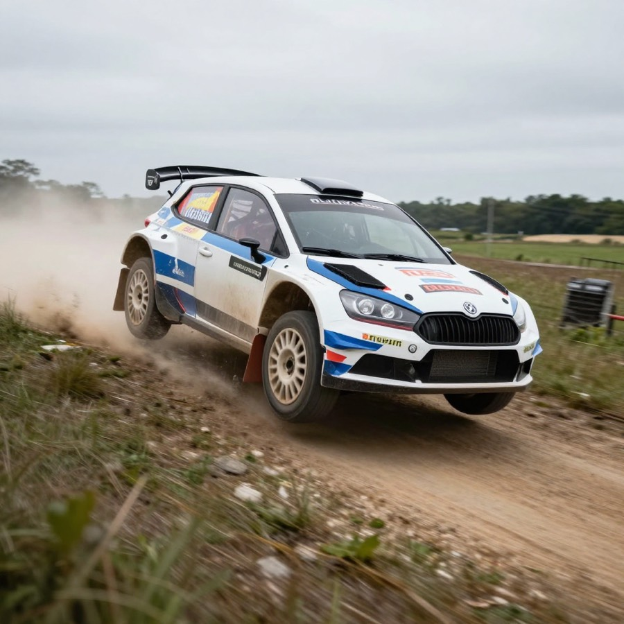</a>

# Awesome Seedance 2.5 Flash プロンプト集

> 🎨 140 curated Seedance 2.5 Flash prompts across 7 categories, with preview images.

[](https://github.com/sindresorhus/awesome) [](LICENSE) [](https://github.com/dvuueez33gok/awesome-seedance-2-5-flash-prompts/actions)

[English](README.md) | [简体中文](README_zh.md) | [日本語](README_ja.md)

**[👉 APIMart で Seedance 2.5 Flash を使って生成 · apimart.ai/model/seedance-2-5-flash](https://gola.apimart.ai/k-tPdr6X)**

`https://gola.apimart.ai/k-tPdr6X`
[💰 Pricing](https://gola.apimart.ai/k-4vLh7n) · [🔑 Get an API key](https://gola.apimart.ai/k-UXzDHr)


---

## 目次

1. [Cinematic & Action](#cinematic--action) — 20
2. [Nature & Landscape](#nature--landscape) — 20
3. [Food & Beverage](#food--beverage) — 20
4. [Architecture & Space](#architecture--space) — 20
5. [Abstract & Motion](#abstract--motion) — 20
6. [Product & Commercial](#product--commercial) — 20
7. [Portrait & Character](#portrait--character) — 20
8. [すべてのプロンプト](#すべてのプロンプト)

## Seedance 2.5 Flash とは？

Seedance 2.5 Flash is ByteDance's fast text-to-video model: 480p/720p output, 4-30 second clips, strong prompt adherence for camera and subject motion. This collection curates 140 prompts that are known to work well, each with a preview frame generated from the same prompt.

## 統計

- **140** 件のプロンプト
- **7** カテゴリ
- 最終更新: 2026-11-16
- apimart.ai/model/seedance-2-5-flash

## カテゴリ別

[Cinematic & Action](#cinematic--action), [Nature & Landscape](#nature--landscape), [Food & Beverage](#food--beverage), [Architecture & Space](#architecture--space), [Abstract & Motion](#abstract--motion), [Product & Commercial](#product--commercial), [Portrait & Character](#portrait--character)

---

## すべてのプロンプト

### Cinematic & Action

#### No. 1: A Rally Car Launching Over A Crest


**プロンプト**

```text
a rally car launching over a crest, aerial style, shot on 24mm wide, overcast soft light, 24fps, shallow depth of field, high detail
```

**生成例**

<div align="center"></div>

**詳細**
- カテゴリ: Cinematic & Action
- アスペクト比: 1:1
- プロンプト言語: en

**[👉 このプロンプトで生成](https://gola.apimart.ai/k-tPdr6X)**

---

#### No. 2: A Submarine Descending Into The Deep


**プロンプト**

```text
a submarine descending into the deep, studio style, shot on 100mm macro, practical lamps, 24fps, shallow depth of field, high detail
```

**生成例**

<div align="center">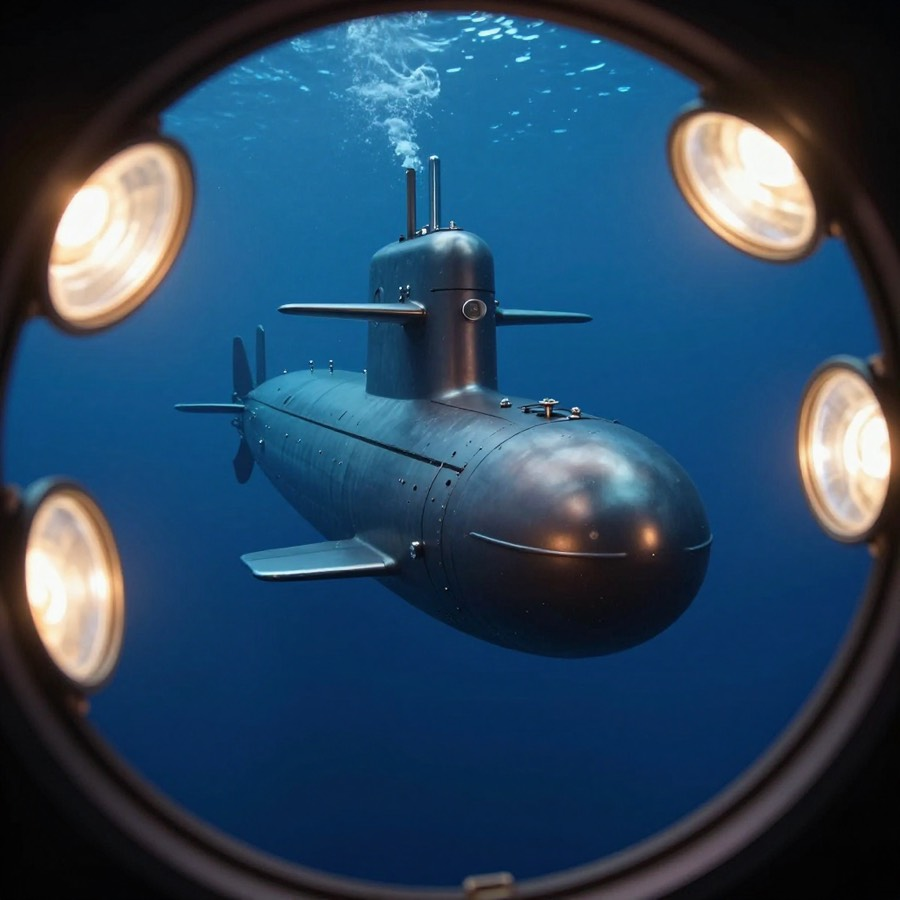</div>

**詳細**
- カテゴリ: Cinematic & Action
- アスペクト比: 1:1
- プロンプト言語: en

**[👉 このプロンプトで生成](https://gola.apimart.ai/k-tPdr6X)**

---

#### No. 3: A Train Crossing A Desert Bridge At Dusk


**プロンプト**

```text
a train crossing a desert bridge at dusk, macro style, shot on 35mm, window light, 24fps, shallow depth of field, high detail
```

**生成例**

<div align="center">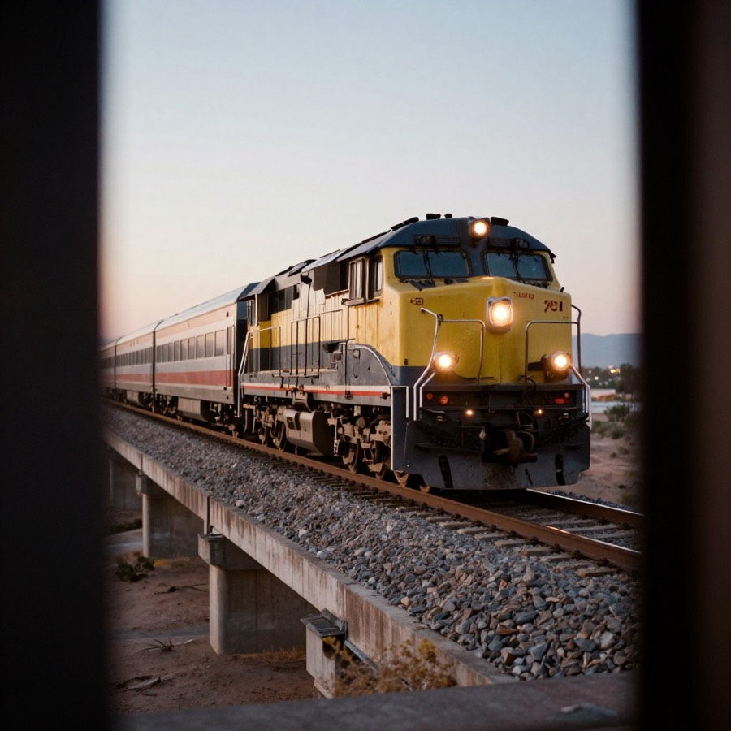</div>

**詳細**
- カテゴリ: Cinematic & Action
- アスペクト比: 1:1
- プロンプト言語: en

**[👉 このプロンプトで生成](https://gola.apimart.ai/k-tPdr6X)**

---

#### No. 4: An Explosion Reflected In A Visor


**プロンプト**

```text
an explosion reflected in a visor, slow motion, studio style, shot on 35mm, hard rim light, 24fps, shallow depth of field, high detail
```

**生成例**

<div align="center">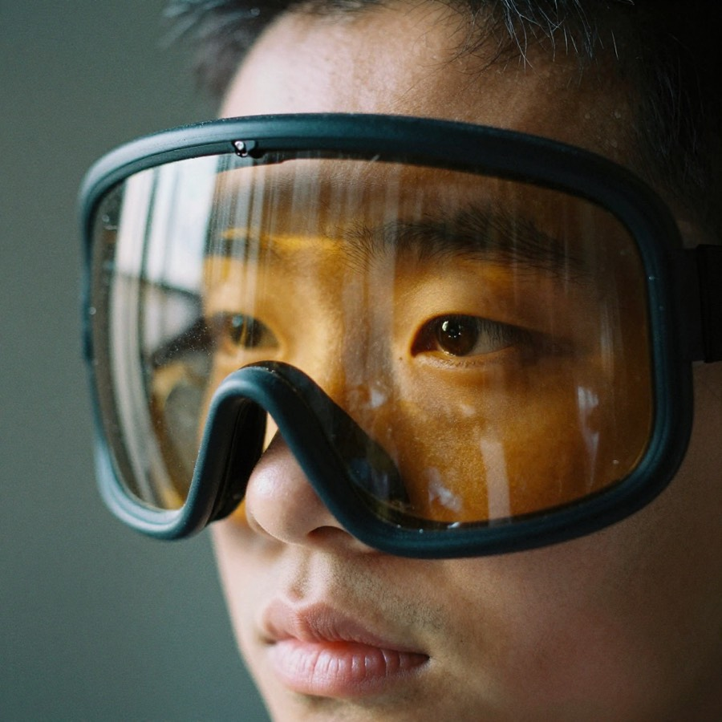</div>

**詳細**
- カテゴリ: Cinematic & Action
- アスペクト比: 1:1
- プロンプト言語: en

**[👉 このプロンプトで生成](https://gola.apimart.ai/k-tPdr6X)**

---

#### No. 5: A City Street Exploding Into Dust


**プロンプト**

```text
a city street exploding into dust, slow motion, macro style, shot on 35mm, practical lamps, 24fps, shallow depth of field, high detail
```

**生成例**

<div align="center">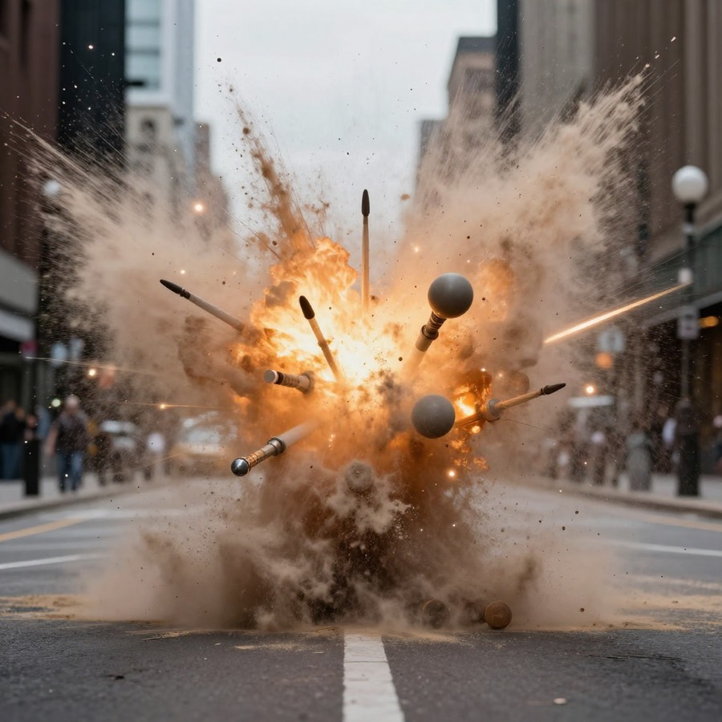</div>

**詳細**
- カテゴリ: Cinematic & Action
- アスペクト比: 1:1
- プロンプト言語: en

**[👉 このプロンプトで生成](https://gola.apimart.ai/k-tPdr6X)**

---

#### No. 6: A Detective Entering A Foggy Alley


**プロンプト**

```text
a detective entering a foggy alley, tracking, slow motion style, shot on 50mm, overcast soft light, 24fps, shallow depth of field, high detail
```

**生成例**

<div align="center">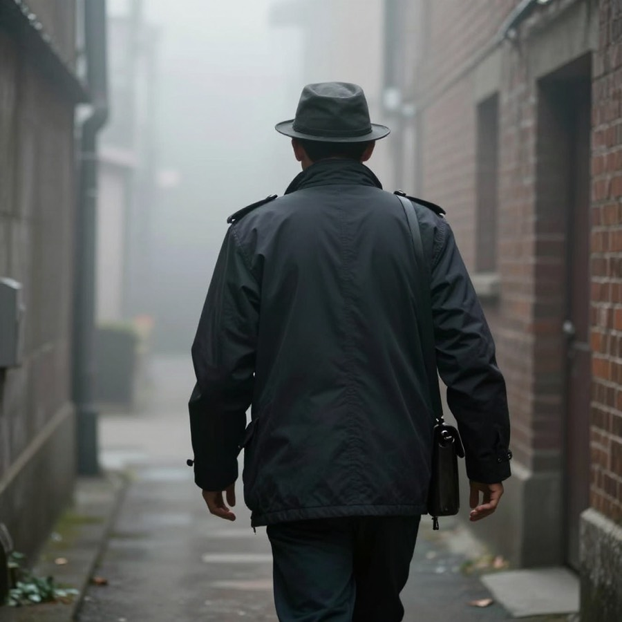</div>

**詳細**
- カテゴリ: Cinematic & Action
- アスペクト比: 1:1
- プロンプト言語: en

**[👉 このプロンプトで生成](https://gola.apimart.ai/k-tPdr6X)**

---

#### No. 7: A Drone Swarm Forming A Shape


**プロンプト**

```text
a drone swarm forming a shape, night sky, handheld documentary style, shot on 50mm, window light, 24fps, shallow depth of field, high detail
```

**生成例**

<div align="center">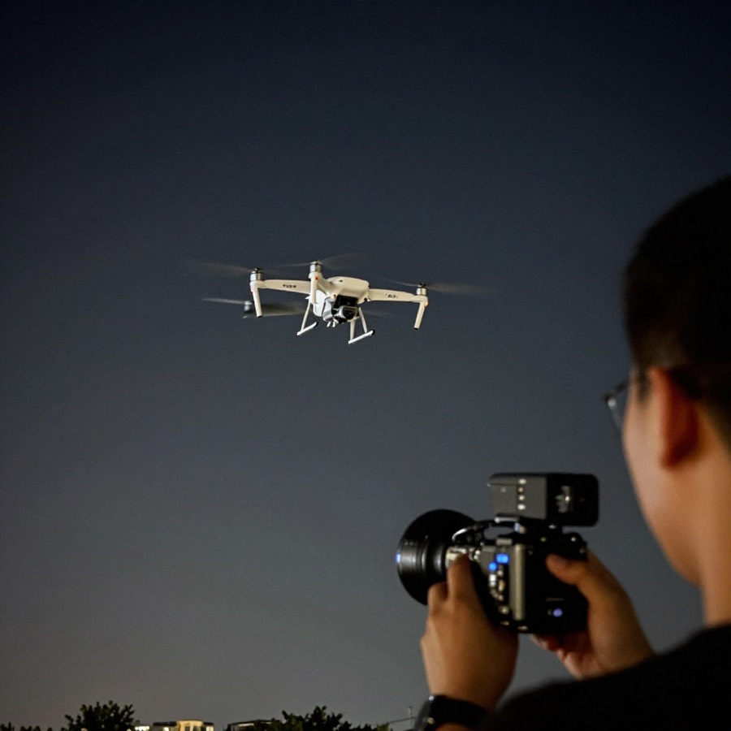</div>

**詳細**
- カテゴリ: Cinematic & Action
- アスペクト比: 1:1
- プロンプト言語: en

**[👉 このプロンプトで生成](https://gola.apimart.ai/k-tPdr6X)**

---

#### No. 8: A Helicopter Skimming A Canyon At Sunset


**プロンプト**

```text
a helicopter skimming a canyon at sunset, aerial style, shot on 100mm macro, practical lamps, 24fps, shallow depth of field, high detail
```

**生成例**

<div align="center">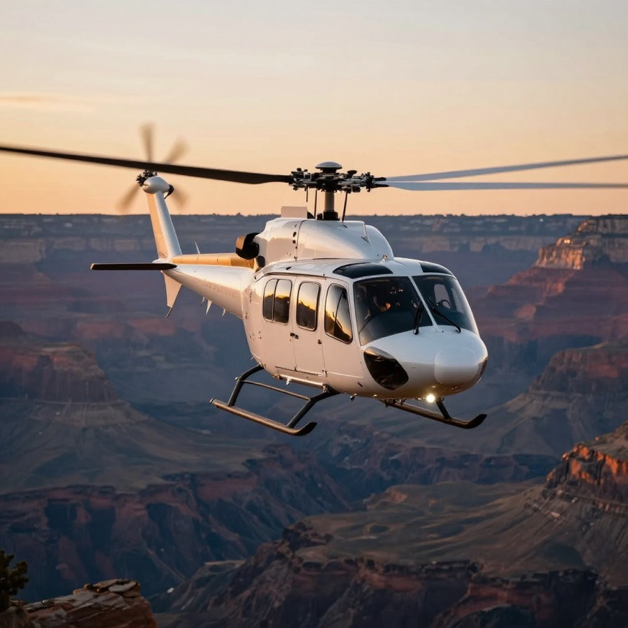</div>

**詳細**
- カテゴリ: Cinematic & Action
- アスペクト比: 1:1
- プロンプト言語: en

**[👉 このプロンプトで生成](https://gola.apimart.ai/k-tPdr6X)**

---

#### No. 9: A Knight Walking Through A Torchlit Hall


**プロンプト**

```text
a knight walking through a torchlit hall, macro style, shot on 85mm, window light, 24fps, shallow depth of field, high detail
```

**生成例**

<div align="center"></div>

**詳細**
- カテゴリ: Cinematic & Action
- アスペクト比: 1:1
- プロンプト言語: en

**[👉 このプロンプトで生成](https://gola.apimart.ai/k-tPdr6X)**

---

#### No. 10: A Spaceship Banking Through An Asteroid Field


**プロンプト**

```text
a spaceship banking through an asteroid field, studio style, shot on 35mm, practical lamps, 24fps, shallow depth of field, high detail
```

**生成例**

<div align="center">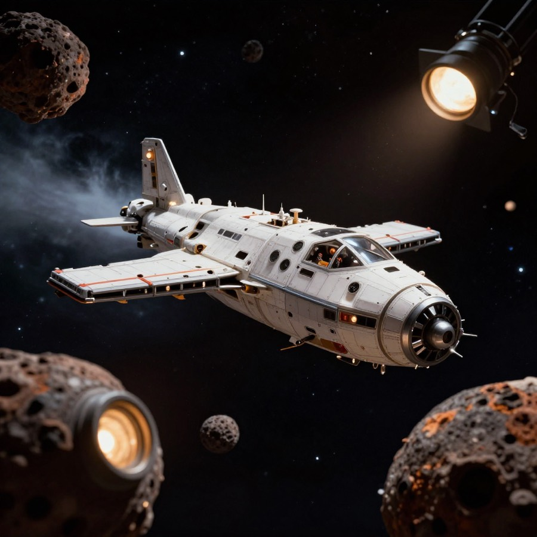</div>

**詳細**
- カテゴリ: Cinematic & Action
- アスペクト比: 1:1
- プロンプト言語: en

**[👉 このプロンプトで生成](https://gola.apimart.ai/k-tPdr6X)**

---

#### No. 11: A Samurai Drawing A Blade


**プロンプト**

```text
a samurai drawing a blade, slow motion, rain, aerial style, shot on 85mm, hard rim light, 24fps, shallow depth of field, high detail
```

**生成例**

<div align="center">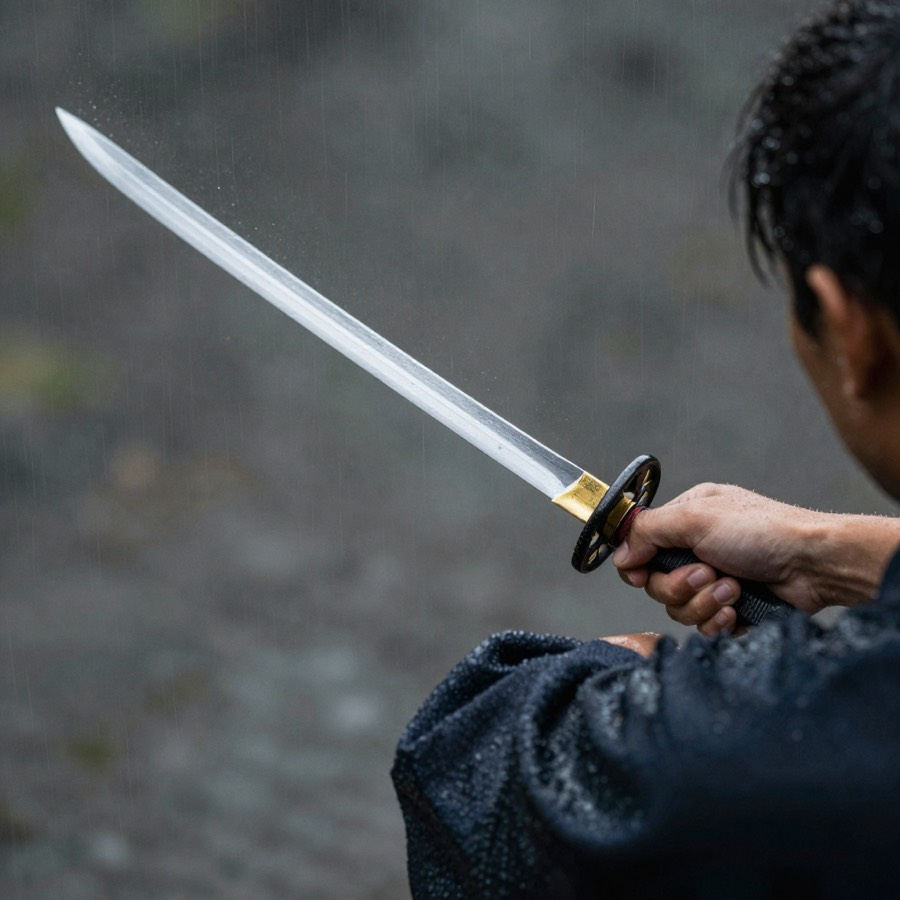</div>

**詳細**
- カテゴリ: Cinematic & Action
- アスペクト比: 1:1
- プロンプト言語: en

**[👉 このプロンプトで生成](https://gola.apimart.ai/k-tPdr6X)**

---

#### No. 12: A Plane Banking Over Mountains


**プロンプト**

```text
a plane banking over mountains, lens flare, slow motion style, shot on 100mm macro, neon night, 24fps, shallow depth of field, high detail
```

**生成例**

<div align="center">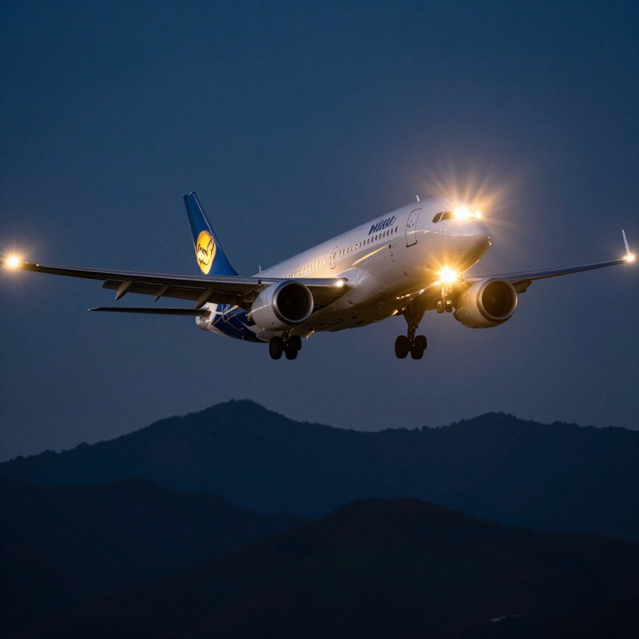</div>

**詳細**
- カテゴリ: Cinematic & Action
- アスペクト比: 1:1
- プロンプト言語: en

**[👉 このプロンプトで生成](https://gola.apimart.ai/k-tPdr6X)**

---

#### No. 13: A Car Drifting Around A Wet Corner


**プロンプト**

```text
a car drifting around a wet corner, spray flying, cinematic style, shot on 35mm, practical lamps, 24fps, shallow depth of field, high detail
```

**生成例**

<div align="center">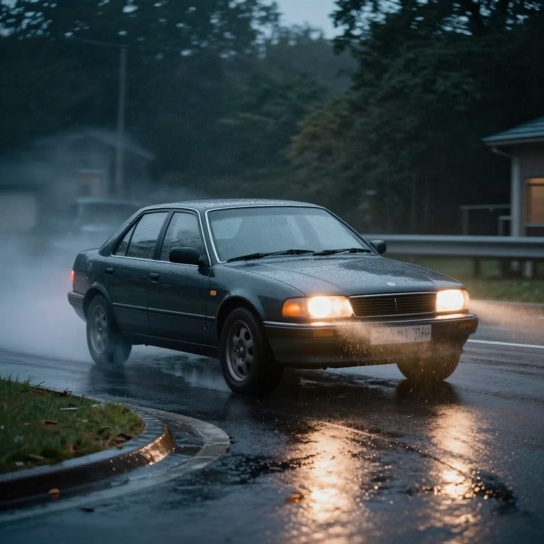</div>

**詳細**
- カテゴリ: Cinematic & Action
- アスペクト比: 1:1
- プロンプト言語: en

**[👉 このプロンプトで生成](https://gola.apimart.ai/k-tPdr6X)**

---

#### No. 14: A Warehouse Chase


**プロンプト**

```text
a warehouse chase, handheld, dust in light beams, cinematic style, shot on 85mm, practical lamps, 24fps, shallow depth of field, high detail
```

**生成例**

<div align="center">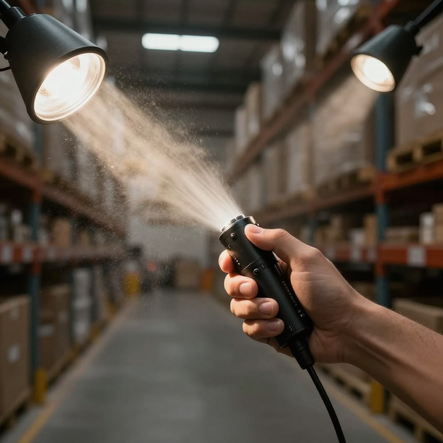</div>

**詳細**
- カテゴリ: Cinematic & Action
- アスペクト比: 1:1
- プロンプト言語: en

**[👉 このプロンプトで生成](https://gola.apimart.ai/k-tPdr6X)**

---

#### No. 15: A Skydiver Falling Through Clouds


**プロンプト**

```text
a skydiver falling through clouds, POV, macro style, shot on 35mm, golden hour, 24fps, shallow depth of field, high detail
```

**生成例**

<div align="center">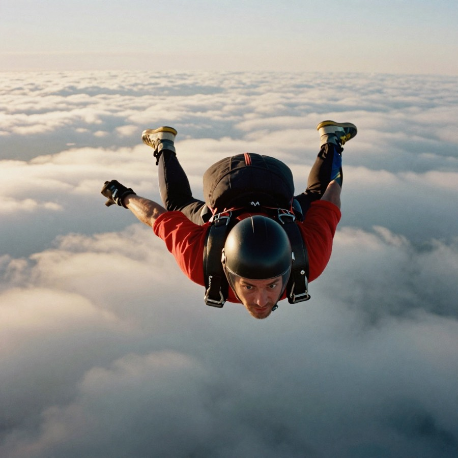</div>

**詳細**
- カテゴリ: Cinematic & Action
- アスペクト比: 1:1
- プロンプト言語: en

**[👉 このプロンプトで生成](https://gola.apimart.ai/k-tPdr6X)**

---

#### No. 16: A Motorcycle Jump Over A Ridge


**プロンプト**

```text
a motorcycle jump over a ridge, dust trail, slow motion style, shot on 100mm macro, overcast soft light, 24fps, shallow depth of field, high detail
```

**生成例**

<div align="center">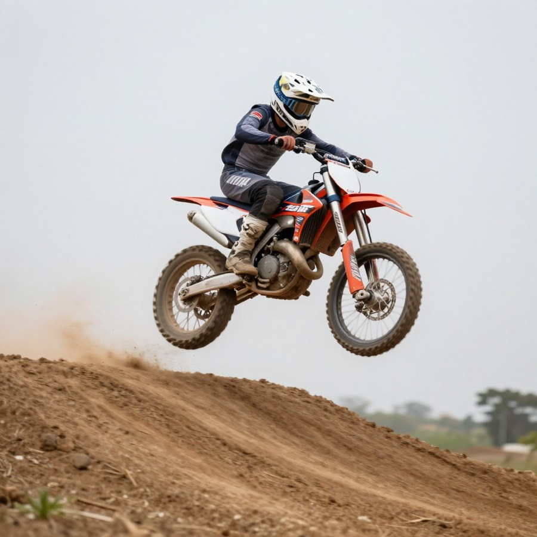</div>

**詳細**
- カテゴリ: Cinematic & Action
- アスペクト比: 1:1
- プロンプト言語: en

**[👉 このプロンプトで生成](https://gola.apimart.ai/k-tPdr6X)**

---

#### No. 17: A Rooftop Chase At Night


**プロンプト**

```text
a rooftop chase at night, neon reflections, studio style, shot on 35mm, practical lamps, 24fps, shallow depth of field, high detail
```

**生成例**

<div align="center">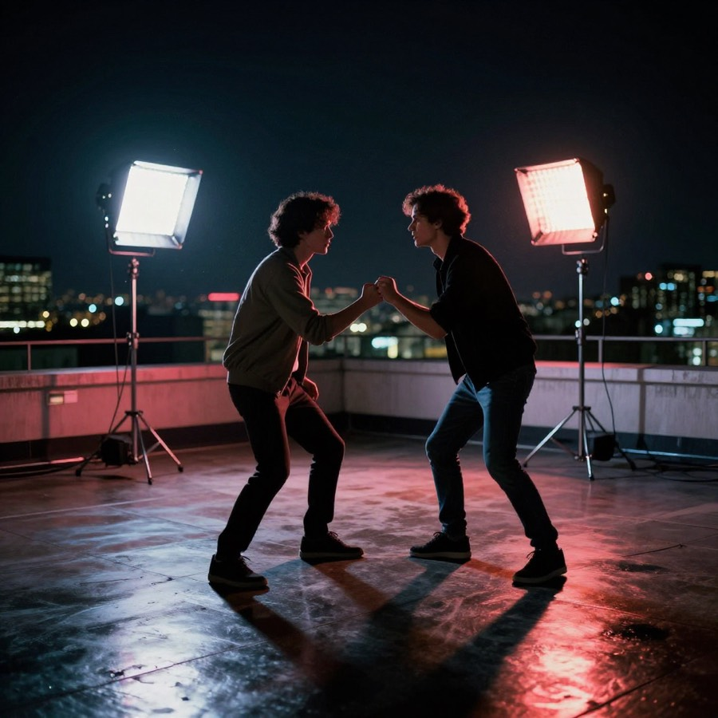</div>

**詳細**
- カテゴリ: Cinematic & Action
- アスペクト比: 1:1
- プロンプト言語: en

**[👉 このプロンプトで生成](https://gola.apimart.ai/k-tPdr6X)**

---

#### No. 18: A Surfer Carving A Wave


**プロンプト**

```text
a surfer carving a wave, water spray, macro style, shot on 35mm, practical lamps, 24fps, shallow depth of field, high detail
```

**生成例**

<div align="center">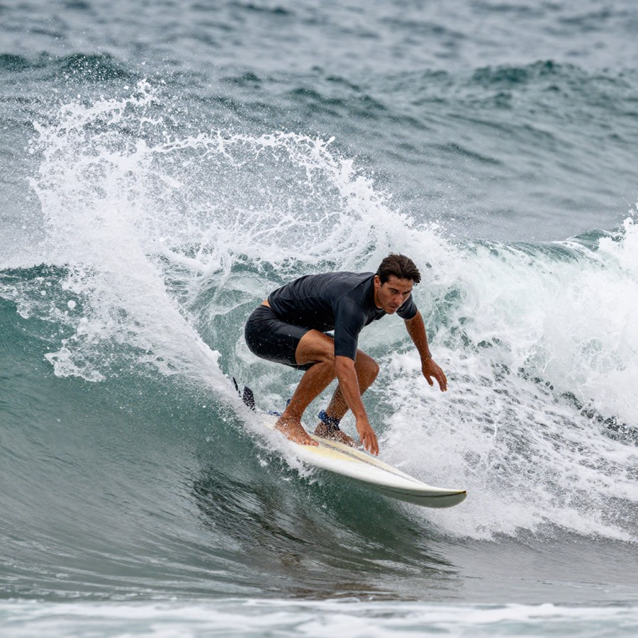</div>

**詳細**
- カテゴリ: Cinematic & Action
- アスペクト比: 1:1
- プロンプト言語: en

**[👉 このプロンプトで生成](https://gola.apimart.ai/k-tPdr6X)**

---

#### No. 19: A Sword Fight In A Bamboo Forest


**プロンプト**

```text
a sword fight in a bamboo forest, slow motion style, shot on 50mm, practical lamps, 24fps, shallow depth of field, high detail
```

**生成例**

<div align="center">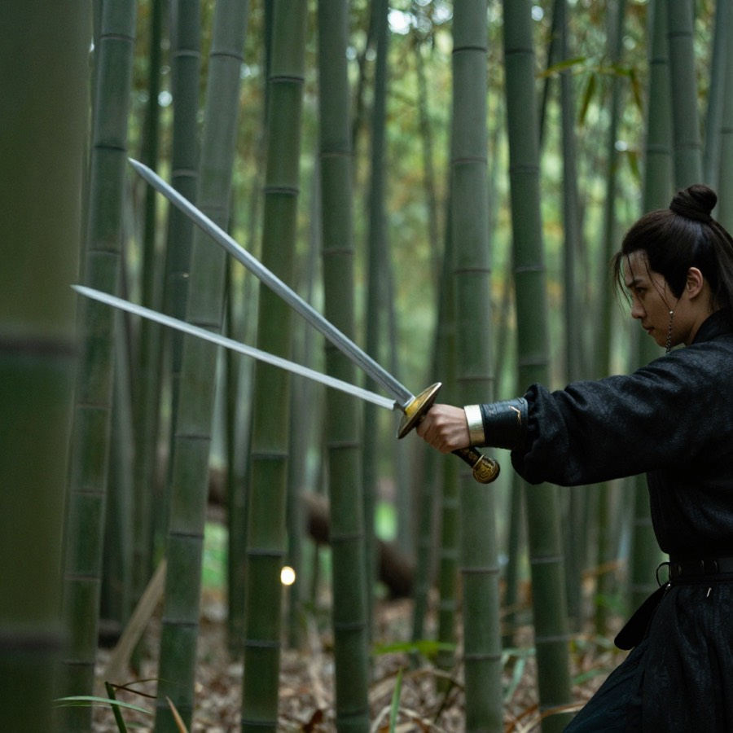</div>

**詳細**
- カテゴリ: Cinematic & Action
- アスペクト比: 1:1
- プロンプト言語: en

**[👉 このプロンプトで生成](https://gola.apimart.ai/k-tPdr6X)**

---

#### No. 20: A Mech Stepping Through A Ruined City


**プロンプト**

```text
a mech stepping through a ruined city, aerial style, shot on 100mm macro, overcast soft light, 24fps, shallow depth of field, high detail
```

**生成例**

<div align="center">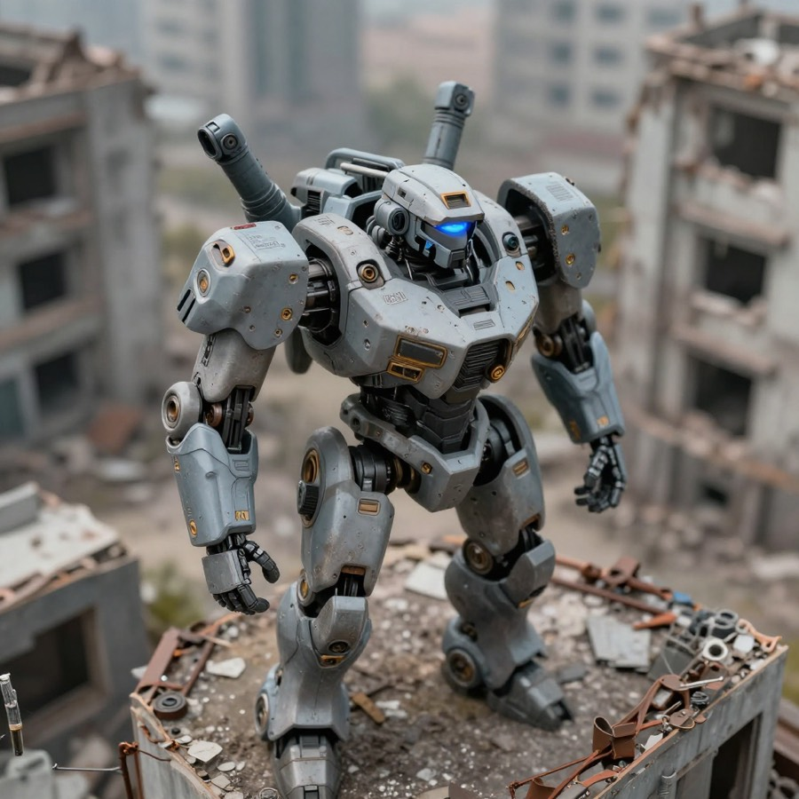</div>

**詳細**
- カテゴリ: Cinematic & Action
- アスペクト比: 1:1
- プロンプト言語: en

**[👉 このプロンプトで生成](https://gola.apimart.ai/k-tPdr6X)**

---

### Nature & Landscape

#### No. 21: Snow Drifting Through Bare Branches


**プロンプト**

```text
snow drifting through bare branches, slow motion, aerial style, shot on 100mm macro, practical lamps, 24fps, shallow depth of field, high detail
```

**生成例**

<div align="center">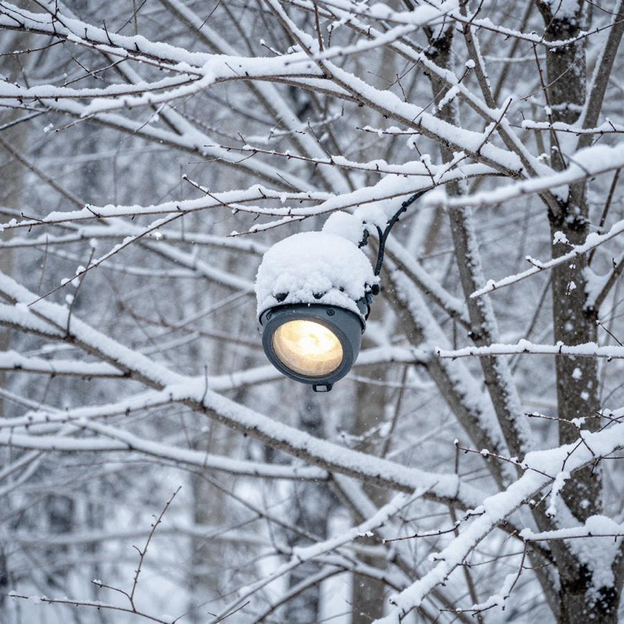</div>

**詳細**
- カテゴリ: Nature & Landscape
- アスペクト比: 1:1
- プロンプト言語: en

**[👉 このプロンプトで生成](https://gola.apimart.ai/k-tPdr6X)**

---

#### No. 22: Wildflowers Swaying In Breeze


**プロンプト**

```text
wildflowers swaying in breeze, macro, macro style, shot on 85mm, practical lamps, 24fps, shallow depth of field, high detail
```

**生成例**

<div align="center">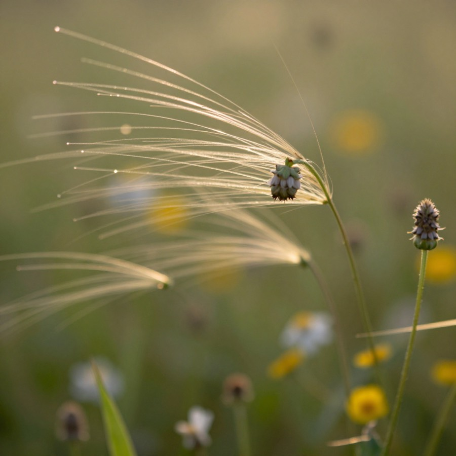</div>

**詳細**
- カテゴリ: Nature & Landscape
- アスペクト比: 1:1
- プロンプト言語: en

**[👉 このプロンプトで生成](https://gola.apimart.ai/k-tPdr6X)**

---

#### No. 23: Waves Crashing On Volcanic Rock


**プロンプト**

```text
waves crashing on volcanic rock, aerial orbit, cinematic style, shot on 50mm, practical lamps, 24fps, shallow depth of field, high detail
```

**生成例**

<div align="center">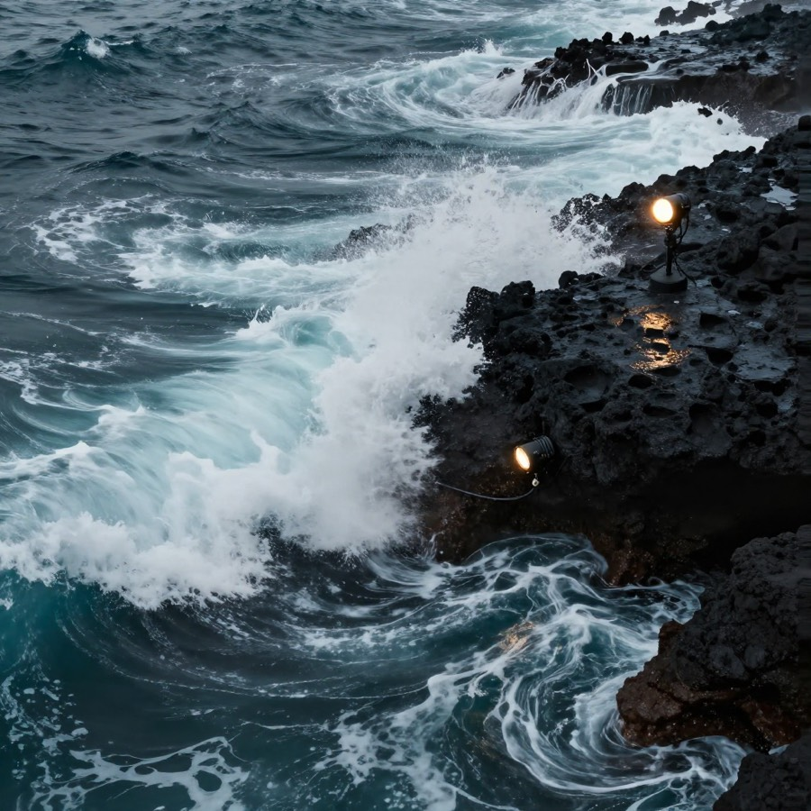</div>

**詳細**
- カテゴリ: Nature & Landscape
- アスペクト比: 1:1
- プロンプト言語: en

**[👉 このプロンプトで生成](https://gola.apimart.ai/k-tPdr6X)**

---

#### No. 24: Lightning Striking A Plain


**プロンプト**

```text
lightning striking a plain, high-speed capture, handheld documentary style, shot on 35mm, golden hour, 24fps, shallow depth of field, high detail
```

**生成例**

<div align="center">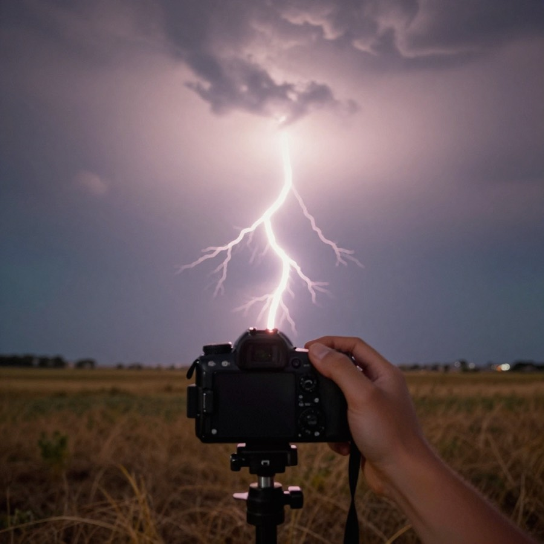</div>

**詳細**
- カテゴリ: Nature & Landscape
- アスペクト比: 1:1
- プロンプト言語: en

**[👉 このプロンプトで生成](https://gola.apimart.ai/k-tPdr6X)**

---

#### No. 25: A Coral Reef With Fish


**プロンプト**

```text
a coral reef with fish, underwater drift, slow motion style, shot on 50mm, hard rim light, 24fps, shallow depth of field, high detail
```

**生成例**

<div align="center">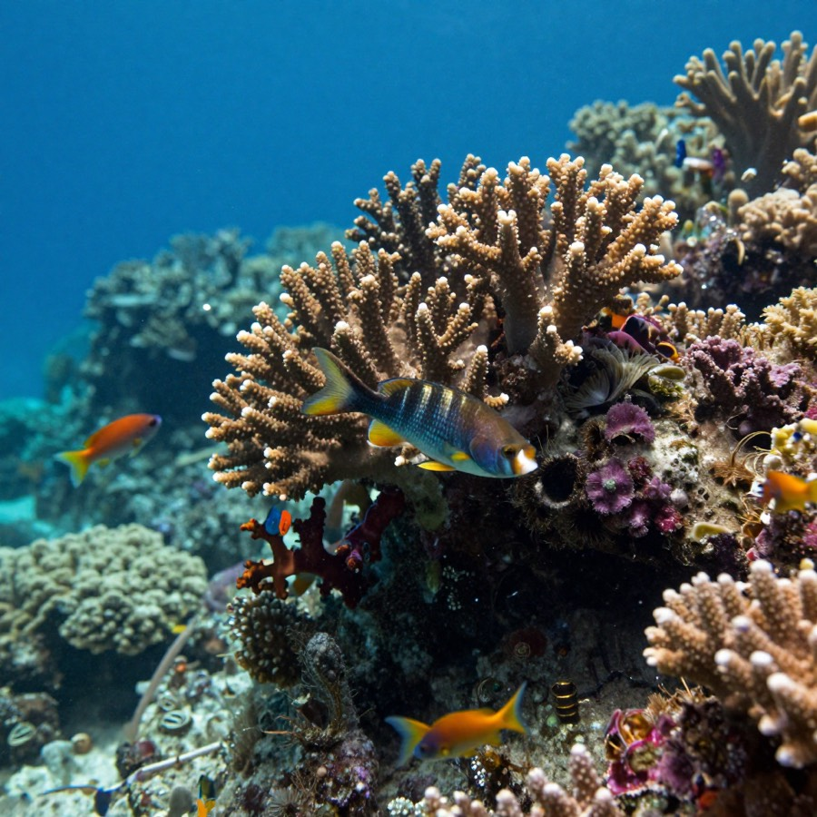</div>

**詳細**
- カテゴリ: Nature & Landscape
- アスペクト比: 1:1
- プロンプト言語: en

**[👉 このプロンプトで生成](https://gola.apimart.ai/k-tPdr6X)**

---

#### No. 26: Northern Lights Rippling Over A Frozen Lake


**プロンプト**

```text
northern lights rippling over a frozen lake, macro style, shot on 24mm wide, golden hour, 24fps, shallow depth of field, high detail
```

**生成例**

<div align="center">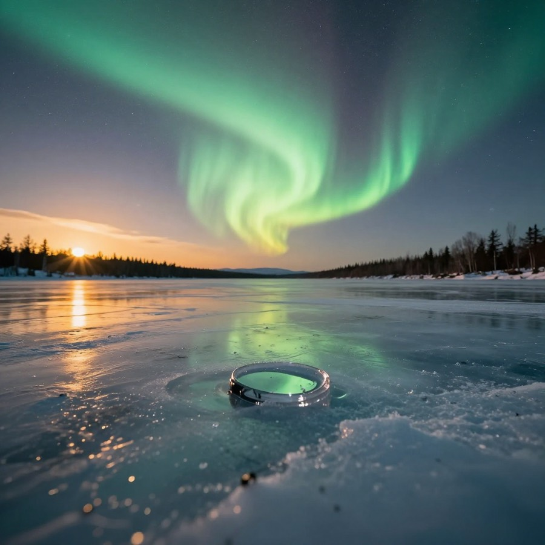</div>

**詳細**
- カテゴリ: Nature & Landscape
- アスペクト比: 1:1
- プロンプト言語: en

**[👉 このプロンプトで生成](https://gola.apimart.ai/k-tPdr6X)**

---

#### No. 27: A Waterfall In Slow Motion


**プロンプト**

```text
a waterfall in slow motion, mist catching light, handheld documentary style, shot on 50mm, neon night, 24fps, shallow depth of field, high detail
```

**生成例**

<div align="center">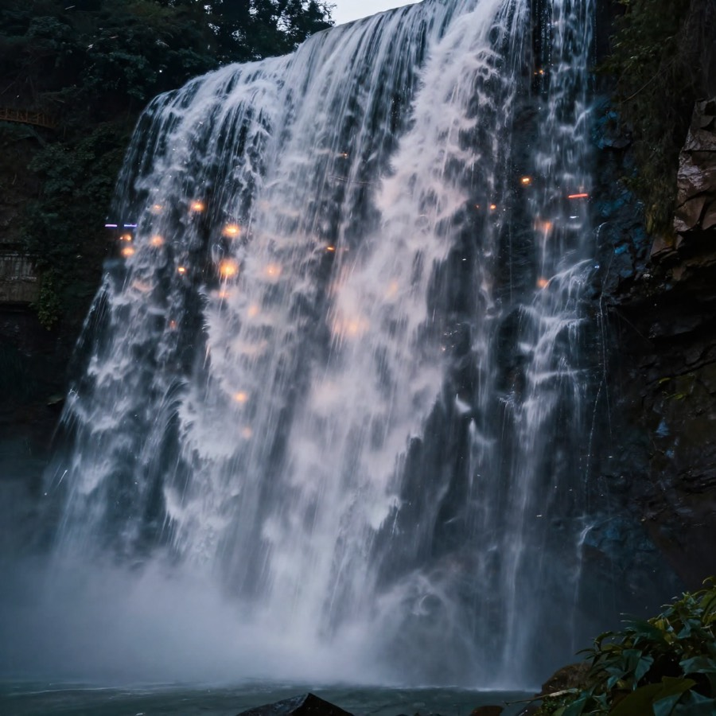</div>

**詳細**
- カテゴリ: Nature & Landscape
- アスペクト比: 1:1
- プロンプト言語: en

**[👉 このプロンプトで生成](https://gola.apimart.ai/k-tPdr6X)**

---

#### No. 28: A River Winding Through A Canyon


**プロンプト**

```text
a river winding through a canyon, drone reveal, macro style, shot on 100mm macro, hard rim light, 24fps, shallow depth of field, high detail
```

**生成例**

<div align="center">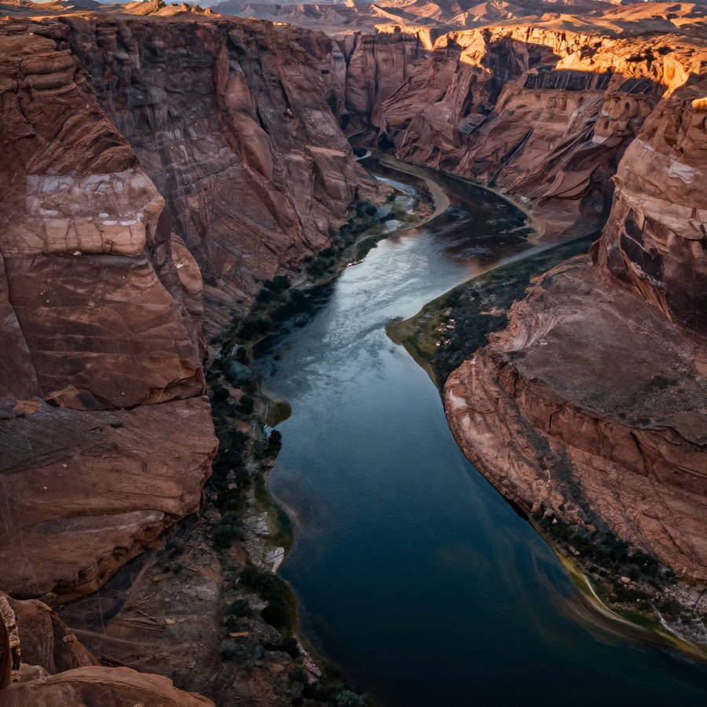</div>

**詳細**
- カテゴリ: Nature & Landscape
- アスペクト比: 1:1
- プロンプト言語: en

**[👉 このプロンプトで生成](https://gola.apimart.ai/k-tPdr6X)**

---

#### No. 29: A Waterfall From Inside A Cave


**プロンプト**

```text
a waterfall from inside a cave, light shaft, slow motion style, shot on 50mm, hard rim light, 24fps, shallow depth of field, high detail
```

**生成例**

<div align="center">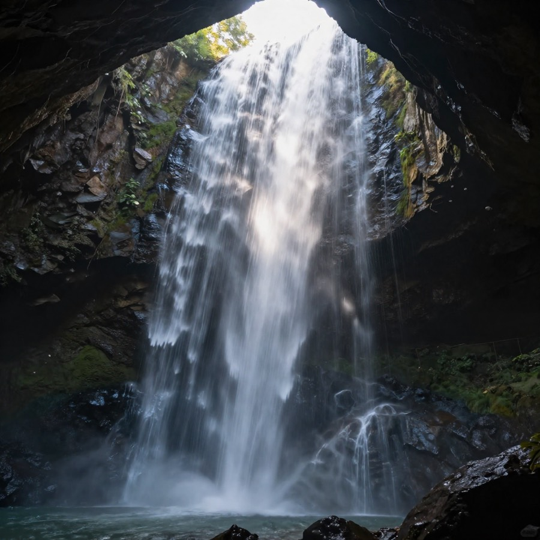</div>

**詳細**
- カテゴリ: Nature & Landscape
- アスペクト比: 1:1
- プロンプト言語: en

**[👉 このプロンプトで生成](https://gola.apimart.ai/k-tPdr6X)**

---

#### No. 30: A Hot Air Balloon Rising At Dawn


**プロンプト**

```text
a hot air balloon rising at dawn, macro style, shot on 85mm, hard rim light, 24fps, shallow depth of field, high detail
```

**生成例**

<div align="center">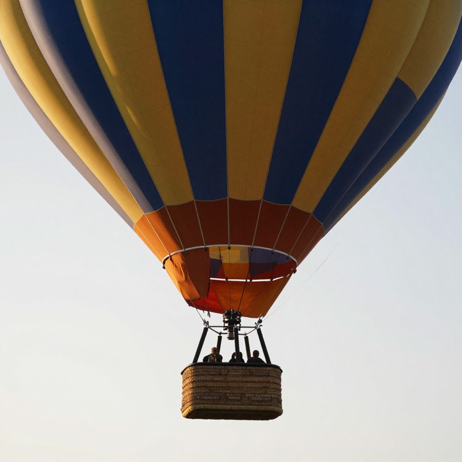</div>

**詳細**
- カテゴリ: Nature & Landscape
- アスペクト比: 1:1
- プロンプト言語: en

**[👉 このプロンプトで生成](https://gola.apimart.ai/k-tPdr6X)**

---

#### No. 31: Clouds Parting Over A Valley


**プロンプト**

```text
clouds parting over a valley, timelapse, cinematic style, shot on 24mm wide, hard rim light, 24fps, shallow depth of field, high detail
```

**生成例**

<div align="center">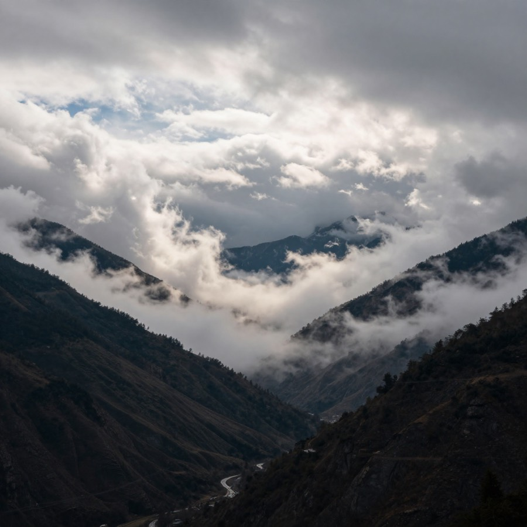</div>

**詳細**
- カテゴリ: Nature & Landscape
- アスペクト比: 1:1
- プロンプト言語: en

**[👉 このプロンプトで生成](https://gola.apimart.ai/k-tPdr6X)**

---

#### No. 32: Autumn Leaves Falling In A Park


**プロンプト**

```text
autumn leaves falling in a park, shallow focus, slow motion style, shot on 100mm macro, neon night, 24fps, shallow depth of field, high detail
```

**生成例**

<div align="center">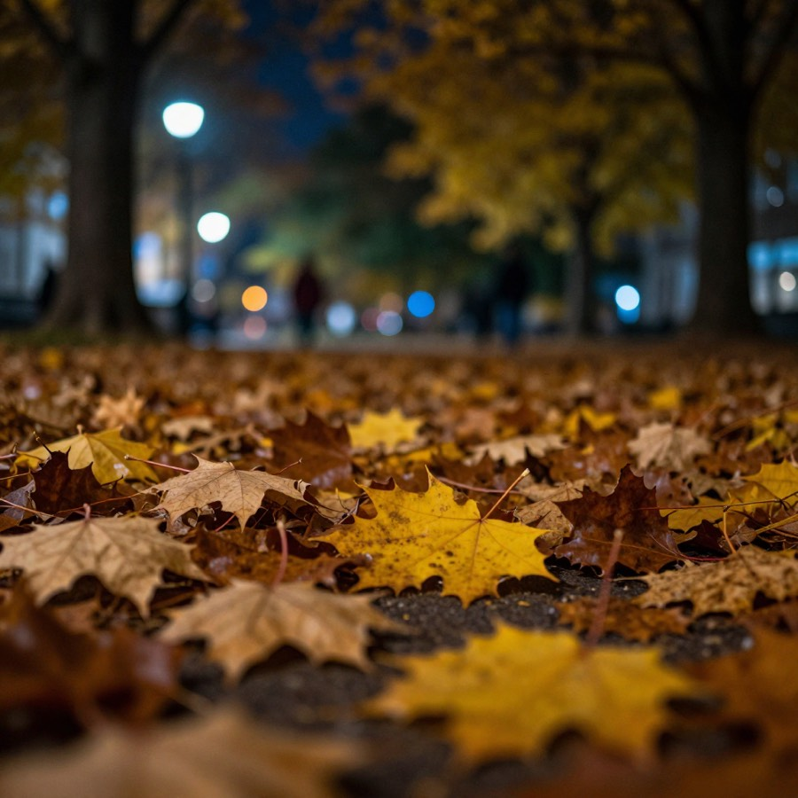</div>

**詳細**
- カテゴリ: Nature & Landscape
- アスペクト比: 1:1
- プロンプト言語: en

**[👉 このプロンプトで生成](https://gola.apimart.ai/k-tPdr6X)**

---

#### No. 33: Rain Hitting A Puddle


**プロンプト**

```text
rain hitting a puddle, reflection ripple macro, studio style, shot on 35mm, hard rim light, 24fps, shallow depth of field, high detail
```

**生成例**

<div align="center">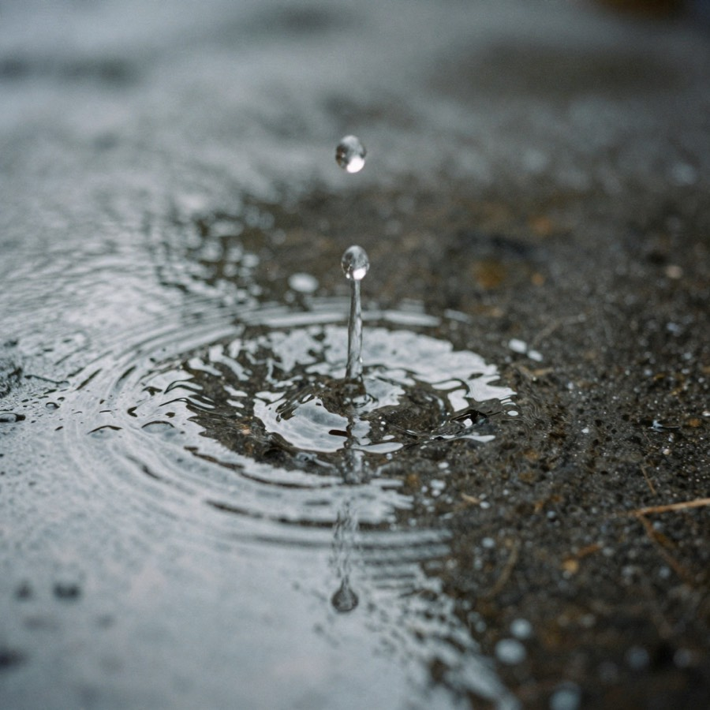</div>

**詳細**
- カテゴリ: Nature & Landscape
- アスペクト比: 1:1
- プロンプト言語: en

**[👉 このプロンプトで生成](https://gola.apimart.ai/k-tPdr6X)**

---

#### No. 34: A Campfire At Night


**プロンプト**

```text
a campfire at night, embers rising, slow motion style, shot on 35mm, neon night, 24fps, shallow depth of field, high detail
```

**生成例**

<div align="center">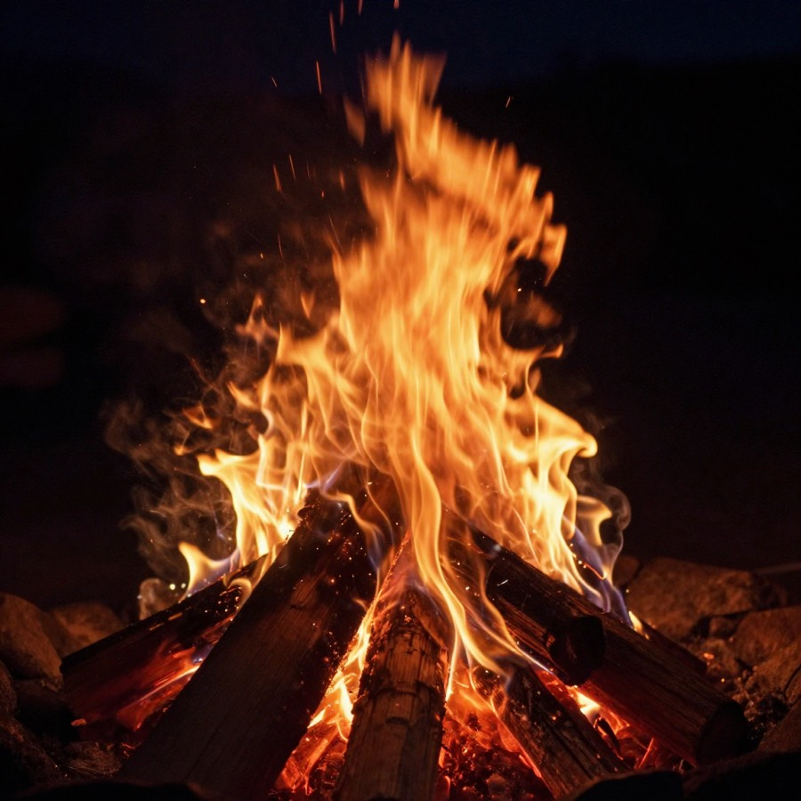</div>

**詳細**
- カテゴリ: Nature & Landscape
- アスペクト比: 1:1
- プロンプト言語: en

**[👉 このプロンプトで生成](https://gola.apimart.ai/k-tPdr6X)**

---

#### No. 35: Fog Rolling Through Pine Forest


**プロンプト**

```text
fog rolling through pine forest, dolly forward, aerial style, shot on 35mm, overcast soft light, 24fps, shallow depth of field, high detail
```

**生成例**

<div align="center">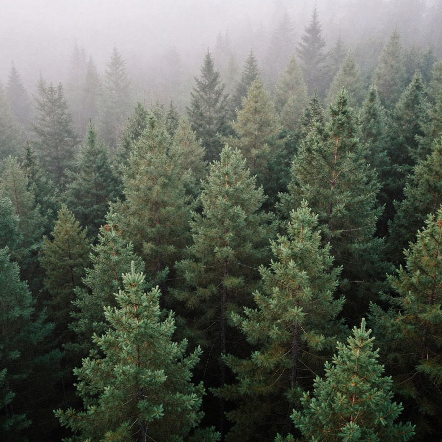</div>

**詳細**
- カテゴリ: Nature & Landscape
- アスペクト比: 1:1
- プロンプト言語: en

**[👉 このプロンプトで生成](https://gola.apimart.ai/k-tPdr6X)**

---

#### No. 36: A Sunrise Timelapse Over A Mountain Ridge


**プロンプト**

```text
a sunrise timelapse over a mountain ridge, studio style, shot on 100mm macro, golden hour, 24fps, shallow depth of field, high detail
```

**生成例**

<div align="center">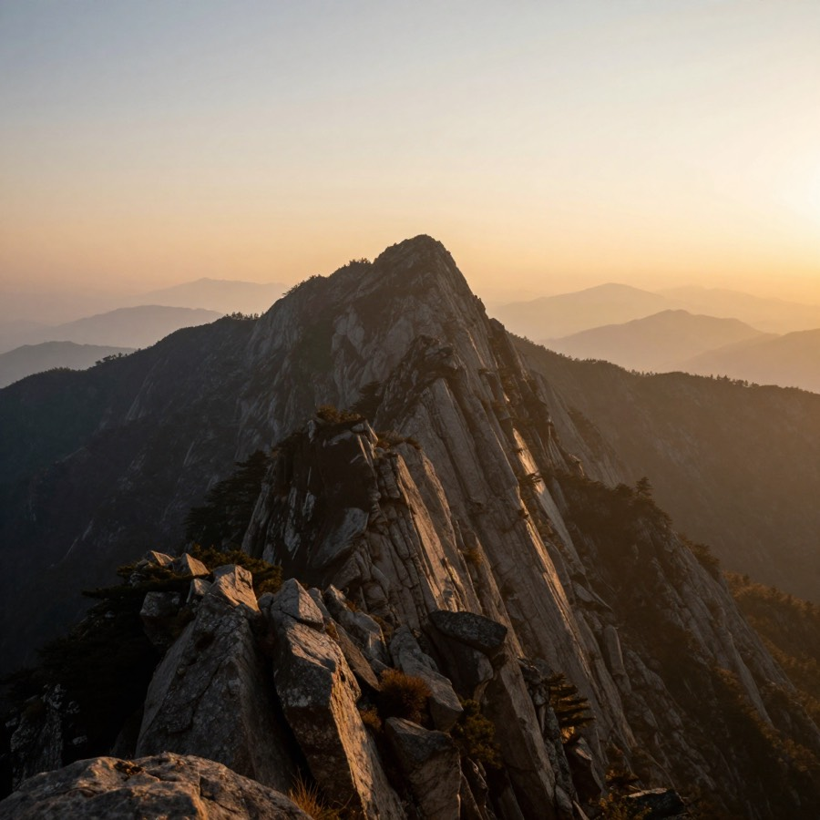</div>

**詳細**
- カテゴリ: Nature & Landscape
- アスペクト比: 1:1
- プロンプト言語: en

**[👉 このプロンプトで生成](https://gola.apimart.ai/k-tPdr6X)**

---

#### No. 37: A Fox Walking Through Snow


**プロンプト**

```text
a fox walking through snow, telephoto, cinematic style, shot on 35mm, overcast soft light, 24fps, shallow depth of field, high detail
```

**生成例**

<div align="center">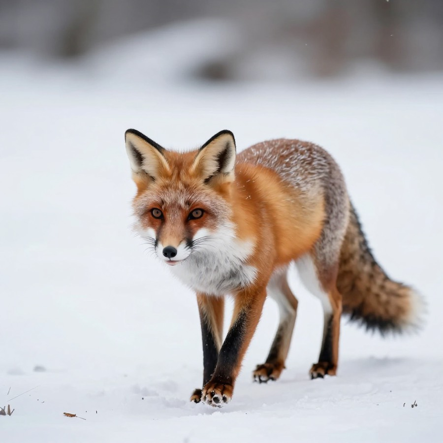</div>

**詳細**
- カテゴリ: Nature & Landscape
- アスペクト比: 1:1
- プロンプト言語: en

**[👉 このプロンプトで生成](https://gola.apimart.ai/k-tPdr6X)**

---

#### No. 38: A Storm Cloud Forming


**プロンプト**

```text
a storm cloud forming, timelapse, aerial style, shot on 24mm wide, hard rim light, 24fps, shallow depth of field, high detail
```

**生成例**

<div align="center">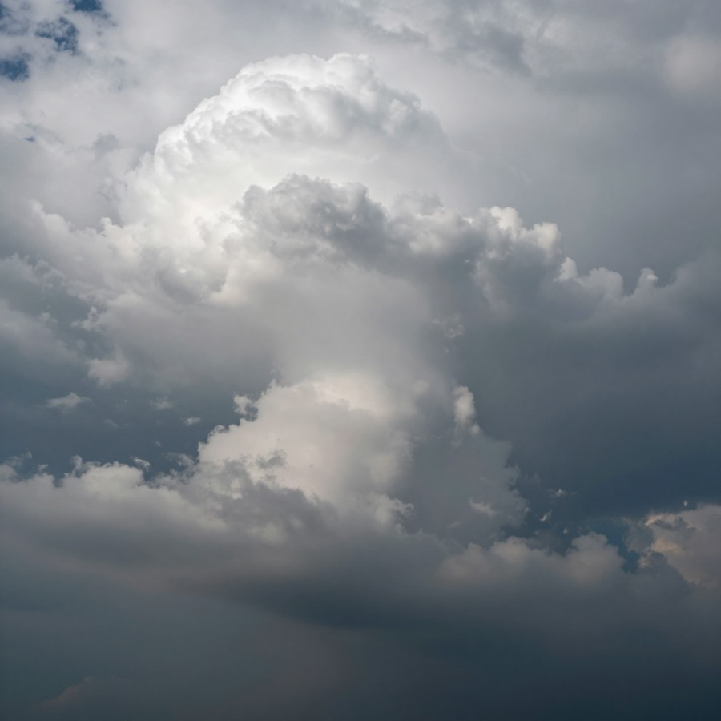</div>

**詳細**
- カテゴリ: Nature & Landscape
- アスペクト比: 1:1
- プロンプト言語: en

**[👉 このプロンプトで生成](https://gola.apimart.ai/k-tPdr6X)**

---

#### No. 39: A Glacier Calving


**プロンプト**

```text
a glacier calving, distant wide shot, macro style, shot on 85mm, window light, 24fps, shallow depth of field, high detail
```

**生成例**

<div align="center">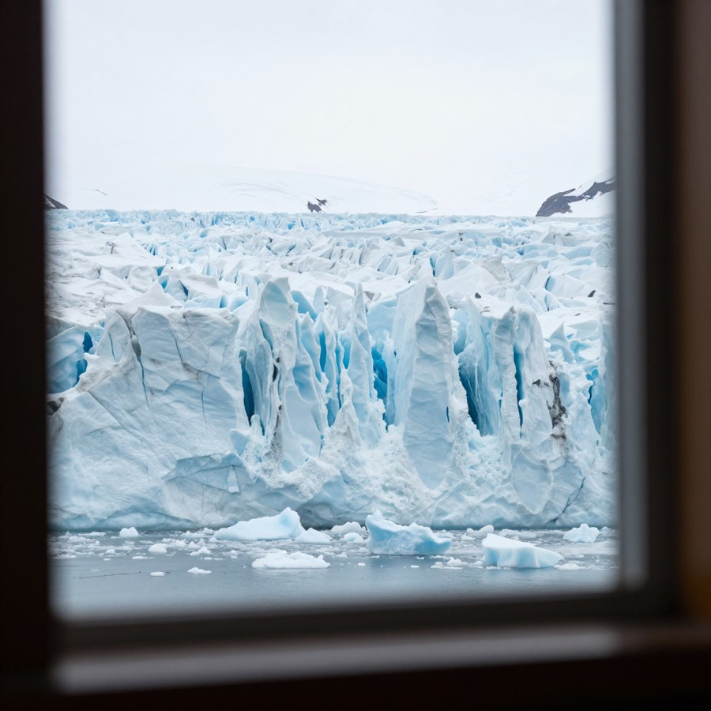</div>

**詳細**
- カテゴリ: Nature & Landscape
- アスペクト比: 1:1
- プロンプト言語: en

**[👉 このプロンプトで生成](https://gola.apimart.ai/k-tPdr6X)**

---

#### No. 40: Desert Dunes Shifting


**プロンプト**

```text
desert dunes shifting, wind ripples, golden hour, handheld documentary style, shot on 85mm, overcast soft light, 24fps, shallow depth of field, high detail
```

**生成例**

<div align="center">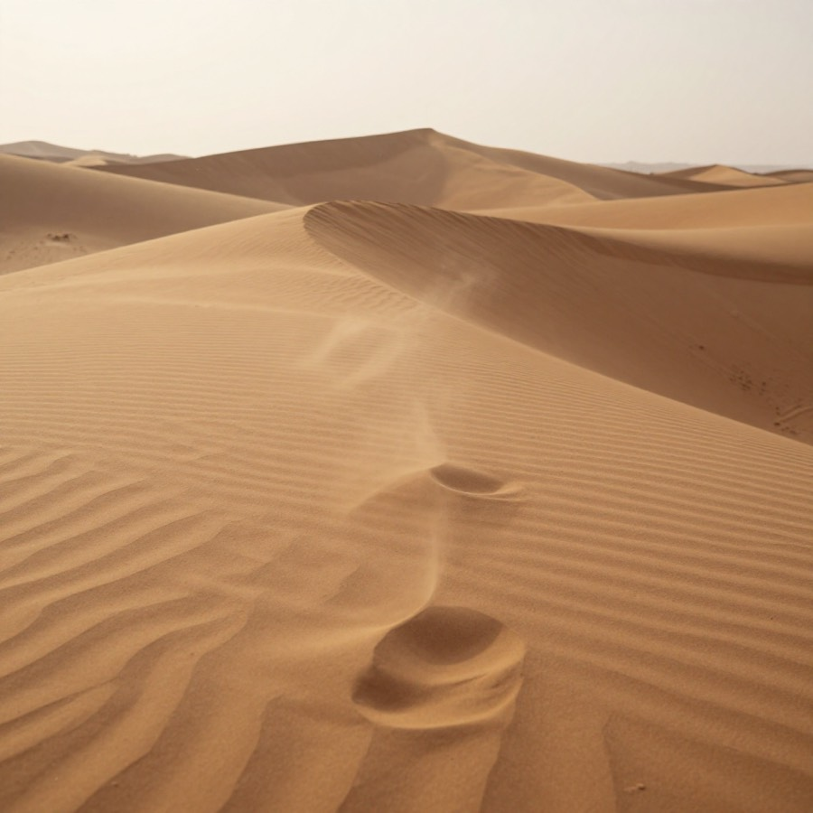</div>

**詳細**
- カテゴリ: Nature & Landscape
- アスペクト比: 1:1
- プロンプト言語: en

**[👉 このプロンプトで生成](https://gola.apimart.ai/k-tPdr6X)**

---

### Food & Beverage

#### No. 41: Sushi Being Sliced With Precision


**プロンプト**

```text
sushi being sliced with precision, close-up, macro style, shot on 24mm wide, practical lamps, 24fps, shallow depth of field, high detail
```

**生成例**

<div align="center">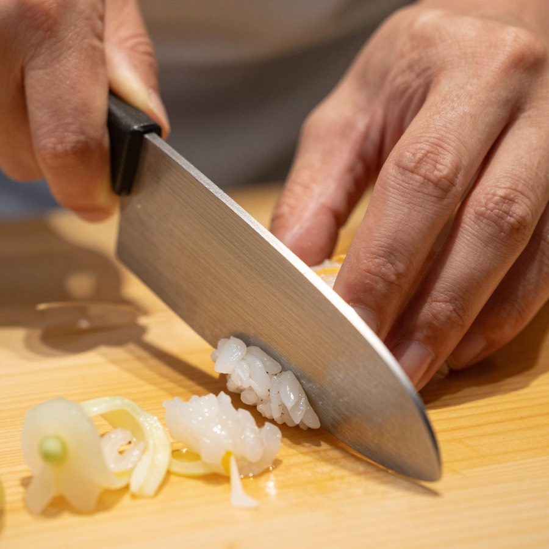</div>

**詳細**
- カテゴリ: Food & Beverage
- アスペクト比: 1:1
- プロンプト言語: en

**[👉 このプロンプトで生成](https://gola.apimart.ai/k-tPdr6X)**

---

#### No. 42: Cheese Pulling Apart In Slow Motion


**プロンプト**

```text
cheese pulling apart in slow motion, macro, cinematic style, shot on 50mm, practical lamps, 24fps, shallow depth of field, high detail
```

**生成例**

<div align="center">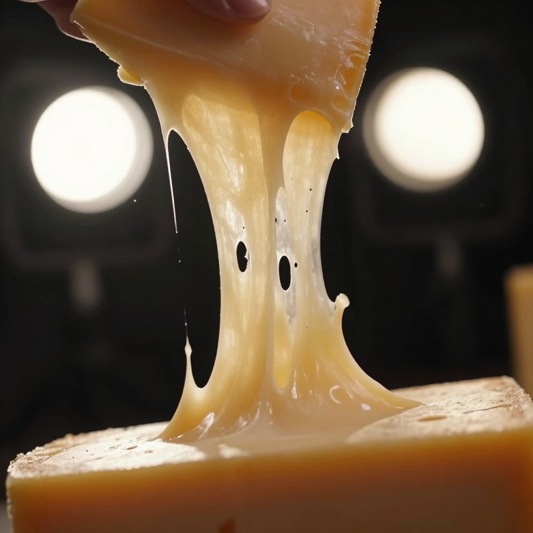</div>

**詳細**
- カテゴリ: Food & Beverage
- アスペクト比: 1:1
- プロンプト言語: en

**[👉 このプロンプトで生成](https://gola.apimart.ai/k-tPdr6X)**

---

#### No. 43: Noodles Being Lifted From Broth


**プロンプト**

```text
noodles being lifted from broth, steam, studio style, shot on 50mm, golden hour, 24fps, shallow depth of field, high detail
```

**生成例**

<div align="center"></div>

**詳細**
- カテゴリ: Food & Beverage
- アスペクト比: 1:1
- プロンプト言語: en

**[👉 このプロンプトで生成](https://gola.apimart.ai/k-tPdr6X)**

---

#### No. 44: An Egg Cracking Into A Pan


**プロンプト**

```text
an egg cracking into a pan, slow motion, slow motion style, shot on 24mm wide, golden hour, 24fps, shallow depth of field, high detail
```

**生成例**

<div align="center">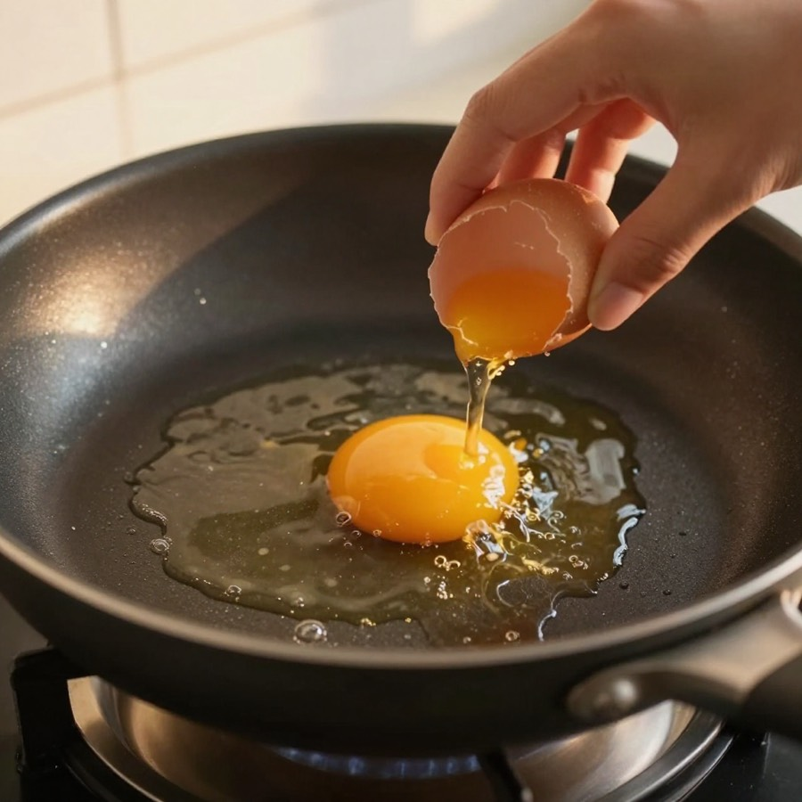</div>

**詳細**
- カテゴリ: Food & Beverage
- アスペクト比: 1:1
- プロンプト言語: en

**[👉 このプロンプトで生成](https://gola.apimart.ai/k-tPdr6X)**

---

#### No. 45: A Cake Being Decorated


**プロンプト**

```text
a cake being decorated, icing swirl, macro style, shot on 100mm macro, overcast soft light, 24fps, shallow depth of field, high detail
```

**生成例**

<div align="center">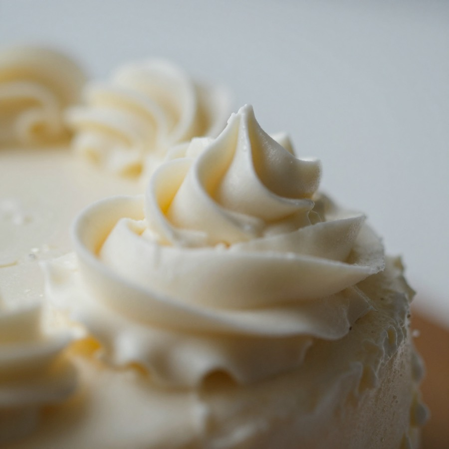</div>

**詳細**
- カテゴリ: Food & Beverage
- アスペクト比: 1:1
- プロンプト言語: en

**[👉 このプロンプトで生成](https://gola.apimart.ai/k-tPdr6X)**

---

#### No. 46: A Chocolate Fountain Running


**プロンプト**

```text
a chocolate fountain running, slow motion, handheld documentary style, shot on 85mm, hard rim light, 24fps, shallow depth of field, high detail
```

**生成例**

<div align="center">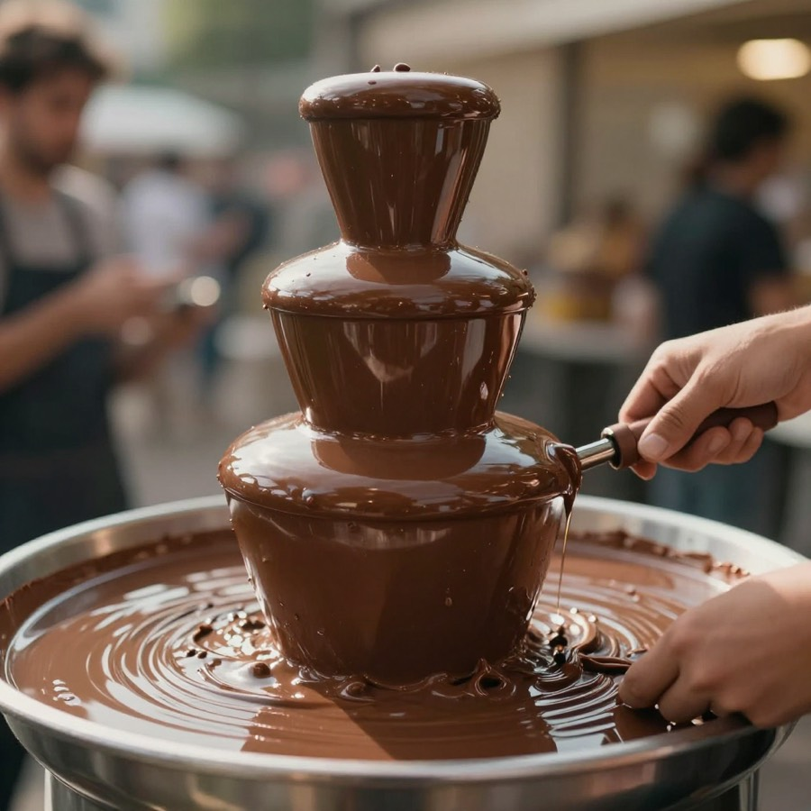</div>

**詳細**
- カテゴリ: Food & Beverage
- アスペクト比: 1:1
- プロンプト言語: en

**[👉 このプロンプトで生成](https://gola.apimart.ai/k-tPdr6X)**

---

#### No. 47: Honey Dripping Into Yogurt


**プロンプト**

```text
honey dripping into yogurt, macro, aerial style, shot on 85mm, window light, 24fps, shallow depth of field, high detail
```

**生成例**

<div align="center">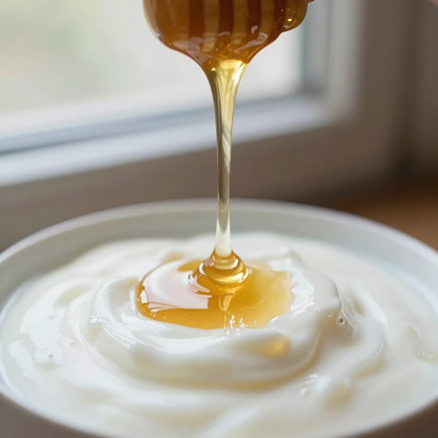</div>

**詳細**
- カテゴリ: Food & Beverage
- アスペクト比: 1:1
- プロンプト言語: en

**[👉 このプロンプトで生成](https://gola.apimart.ai/k-tPdr6X)**

---

#### No. 48: A Grill Flame Flaring Over Skewers


**プロンプト**

```text
a grill flame flaring over skewers, handheld documentary style, shot on 24mm wide, overcast soft light, 24fps, shallow depth of field, high detail
```

**生成例**

<div align="center">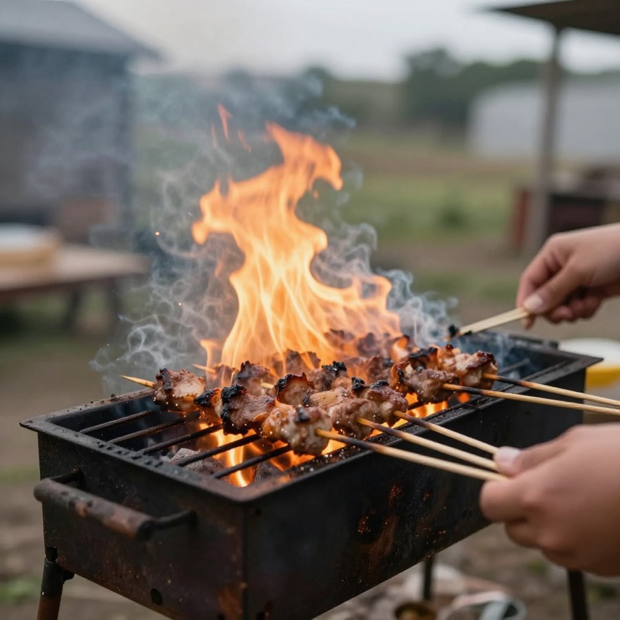</div>

**詳細**
- カテゴリ: Food & Beverage
- アスペクト比: 1:1
- プロンプト言語: en

**[👉 このプロンプトで生成](https://gola.apimart.ai/k-tPdr6X)**

---

#### No. 49: Dough Rising In A Timelapse


**プロンプト**

```text
dough rising in a timelapse, handheld documentary style, shot on 24mm wide, overcast soft light, 24fps, shallow depth of field, high detail
```

**生成例**

<div align="center">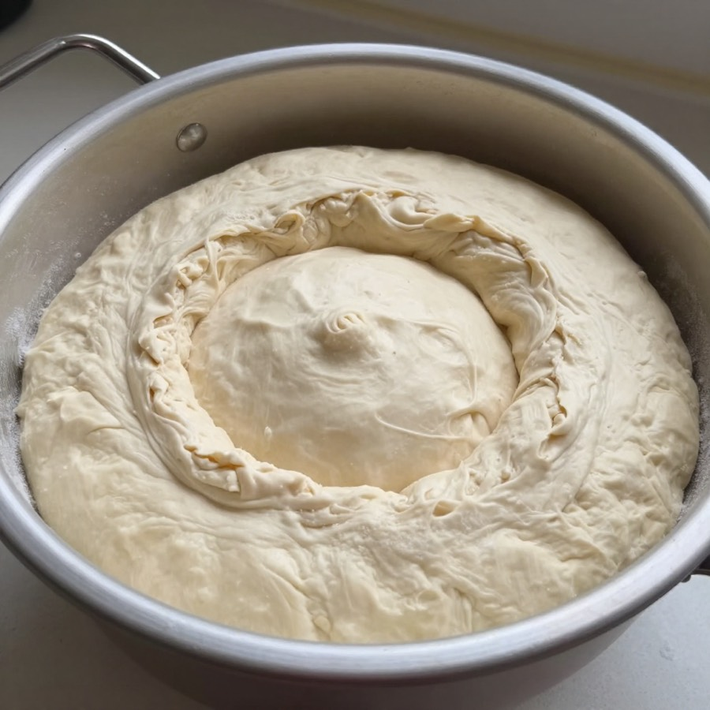</div>

**詳細**
- カテゴリ: Food & Beverage
- アスペクト比: 1:1
- プロンプト言語: en

**[👉 このプロンプトで生成](https://gola.apimart.ai/k-tPdr6X)**

---

#### No. 50: A Tea Ceremony


**プロンプト**

```text
a tea ceremony, steam curling, cinematic style, shot on 85mm, hard rim light, 24fps, shallow depth of field, high detail
```

**生成例**

<div align="center">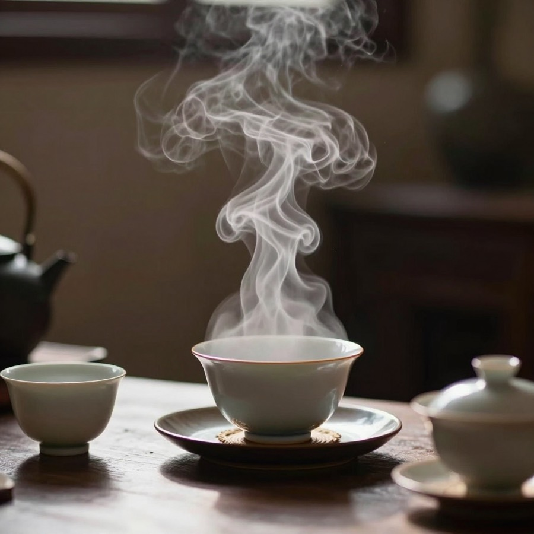</div>

**詳細**
- カテゴリ: Food & Beverage
- アスペクト比: 1:1
- プロンプト言語: en

**[👉 このプロンプトで生成](https://gola.apimart.ai/k-tPdr6X)**

---

#### No. 51: Steak Searing In A Pan


**プロンプト**

```text
steak searing in a pan, butter basting, studio style, shot on 85mm, overcast soft light, 24fps, shallow depth of field, high detail
```

**生成例**

<div align="center">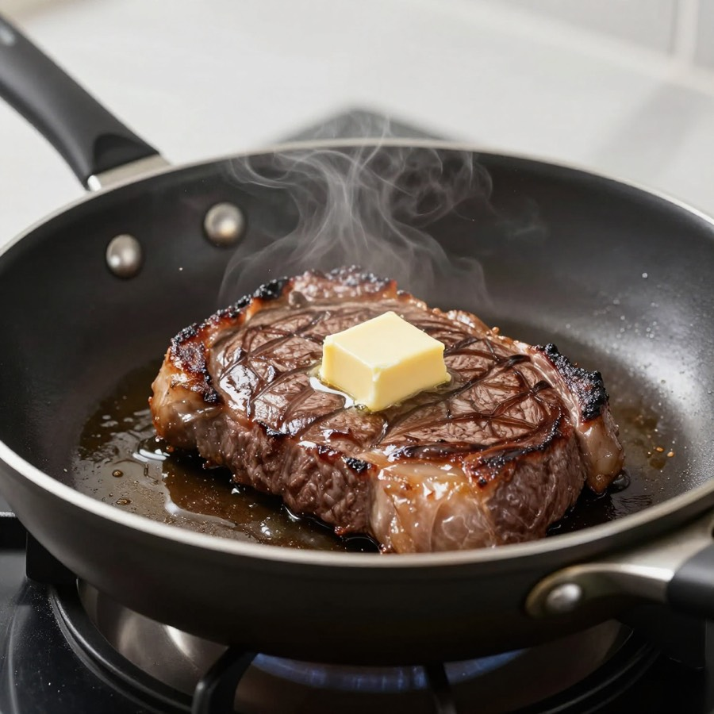</div>

**詳細**
- カテゴリ: Food & Beverage
- アスペクト比: 1:1
- プロンプト言語: en

**[👉 このプロンプトで生成](https://gola.apimart.ai/k-tPdr6X)**

---

#### No. 52: A Cocktail Being Shaken With Ice


**プロンプト**

```text
a cocktail being shaken with ice, slow motion, slow motion style, shot on 100mm macro, practical lamps, 24fps, shallow depth of field, high detail
```

**生成例**

<div align="center">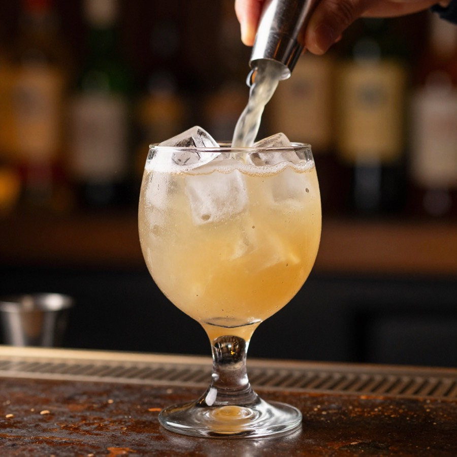</div>

**詳細**
- カテゴリ: Food & Beverage
- アスペクト比: 1:1
- プロンプト言語: en

**[👉 このプロンプトで生成](https://gola.apimart.ai/k-tPdr6X)**

---

#### No. 53: Wine Being Poured Into A Glass


**プロンプト**

```text
wine being poured into a glass, backlit, aerial style, shot on 24mm wide, window light, 24fps, shallow depth of field, high detail
```

**生成例**

<div align="center"></div>

**詳細**
- カテゴリ: Food & Beverage
- アスペクト比: 1:1
- プロンプト言語: en

**[👉 このプロンプトで生成](https://gola.apimart.ai/k-tPdr6X)**

---

#### No. 54: Bread Coming Out Of An Oven


**プロンプト**

```text
bread coming out of an oven, steam, cinematic style, shot on 50mm, practical lamps, 24fps, shallow depth of field, high detail
```

**生成例**

<div align="center"></div>

**詳細**
- カテゴリ: Food & Beverage
- アスペクト比: 1:1
- プロンプト言語: en

**[👉 このプロンプトで生成](https://gola.apimart.ai/k-tPdr6X)**

---

#### No. 55: Cocktail Garnish Being Dropped


**プロンプト**

```text
cocktail garnish being dropped, ripple, handheld documentary style, shot on 85mm, window light, 24fps, shallow depth of field, high detail
```

**生成例**

<div align="center"></div>

**詳細**
- カテゴリ: Food & Beverage
- アスペクト比: 1:1
- プロンプト言語: en

**[👉 このプロンプトで生成](https://gola.apimart.ai/k-tPdr6X)**

---

#### No. 56: Latte Art Being Poured


**プロンプト**

```text
latte art being poured, top-down, handheld documentary style, shot on 85mm, hard rim light, 24fps, shallow depth of field, high detail
```

**生成例**

<div align="center"></div>

**詳細**
- カテゴリ: Food & Beverage
- アスペクト比: 1:1
- プロンプト言語: en

**[👉 このプロンプトで生成](https://gola.apimart.ai/k-tPdr6X)**

---

#### No. 57: Ice Cream Scooping


**プロンプト**

```text
ice cream scooping, macro, macro style, shot on 85mm, overcast soft light, 24fps, shallow depth of field, high detail
```

**生成例**

<div align="center"></div>

**詳細**
- カテゴリ: Food & Beverage
- アスペクト比: 1:1
- プロンプト言語: en

**[👉 このプロンプトで生成](https://gola.apimart.ai/k-tPdr6X)**

---

#### No. 58: Pizza Being Sliced


**プロンプト**

```text
pizza being sliced, cheese stretching, cinematic style, shot on 35mm, window light, 24fps, shallow depth of field, high detail
```

**生成例**

<div align="center"></div>

**詳細**
- カテゴリ: Food & Beverage
- アスペクト比: 1:1
- プロンプト言語: en

**[👉 このプロンプトで生成](https://gola.apimart.ai/k-tPdr6X)**

---

#### No. 59: A Burger Being Assembled


**プロンプト**

```text
a burger being assembled, stop-motion, macro style, shot on 50mm, practical lamps, 24fps, shallow depth of field, high detail
```

**生成例**

<div align="center"></div>

**詳細**
- カテゴリ: Food & Beverage
- アスペクト比: 1:1
- プロンプト言語: en

**[👉 このプロンプトで生成](https://gola.apimart.ai/k-tPdr6X)**

---

#### No. 60: Vegetables Being Chopped


**プロンプト**

```text
vegetables being chopped, knife rhythm, macro style, shot on 85mm, hard rim light, 24fps, shallow depth of field, high detail
```

**生成例**

<div align="center"></div>

**詳細**
- カテゴリ: Food & Beverage
- アスペクト比: 1:1
- プロンプト言語: en

**[👉 このプロンプトで生成](https://gola.apimart.ai/k-tPdr6X)**

---

### Architecture & Space

#### No. 61: A Lighthouse Beam Sweeping At Night


**プロンプト**

```text
a lighthouse beam sweeping at night, handheld documentary style, shot on 24mm wide, window light, 24fps, shallow depth of field, high detail
```

**生成例**

<div align="center"></div>

**詳細**
- カテゴリ: Architecture & Space
- アスペクト比: 1:1
- プロンプト言語: en

**[👉 このプロンプトで生成](https://gola.apimart.ai/k-tPdr6X)**

---

#### No. 62: A Museum Hall With Light Shafts


**プロンプト**

```text
a museum hall with light shafts, dolly forward, handheld documentary style, shot on 100mm macro, practical lamps, 24fps, shallow depth of field, high detail
```

**生成例**

<div align="center"></div>

**詳細**
- カテゴリ: Architecture & Space
- アスペクト比: 1:1
- プロンプト言語: en

**[👉 このプロンプトで生成](https://gola.apimart.ai/k-tPdr6X)**

---

#### No. 63: A Bridge Cables In Fog


**プロンプト**

```text
a bridge cables in fog, slow pan, cinematic style, shot on 100mm macro, neon night, 24fps, shallow depth of field, high detail
```

**生成例**

<div align="center"></div>

**詳細**
- カテゴリ: Architecture & Space
- アスペクト比: 1:1
- プロンプト言語: en

**[👉 このプロンプトで生成](https://gola.apimart.ai/k-tPdr6X)**

---

#### No. 64: A Rooftop View Of A City


**プロンプト**

```text
a rooftop view of a city, clouds timelapse, slow motion style, shot on 24mm wide, overcast soft light, 24fps, shallow depth of field, high detail
```

**生成例**

<div align="center"></div>

**詳細**
- カテゴリ: Architecture & Space
- アスペクト比: 1:1
- プロンプト言語: en

**[👉 このプロンプトで生成](https://gola.apimart.ai/k-tPdr6X)**

---

#### No. 65: A Brutalist Facade


**プロンプト**

```text
a brutalist facade, parallax drift, slow motion style, shot on 85mm, hard rim light, 24fps, shallow depth of field, high detail
```

**生成例**

<div align="center"></div>

**詳細**
- カテゴリ: Architecture & Space
- アスペクト比: 1:1
- プロンプト言語: en

**[👉 このプロンプトで生成](https://gola.apimart.ai/k-tPdr6X)**

---

#### No. 66: A Hotel Lobby


**プロンプト**

```text
a hotel lobby, people passing, time-lapse, macro style, shot on 50mm, golden hour, 24fps, shallow depth of field, high detail
```

**生成例**

<div align="center"></div>

**詳細**
- カテゴリ: Architecture & Space
- アスペクト比: 1:1
- プロンプト言語: en

**[👉 このプロンプトで生成](https://gola.apimart.ai/k-tPdr6X)**

---

#### No. 67: A Greenhouse With Plants


**プロンプト**

```text
a greenhouse with plants, light diffusing, macro style, shot on 50mm, hard rim light, 24fps, shallow depth of field, high detail
```

**生成例**

<div align="center"></div>

**詳細**
- カテゴリ: Architecture & Space
- アスペクト比: 1:1
- プロンプト言語: en

**[👉 このプロンプトで生成](https://gola.apimart.ai/k-tPdr6X)**

---

#### No. 68: A Courtyard With Rain Falling


**プロンプト**

```text
a courtyard with rain falling, ripples, macro style, shot on 35mm, window light, 24fps, shallow depth of field, high detail
```

**生成例**

<div align="center"></div>

**詳細**
- カテゴリ: Architecture & Space
- アスペクト比: 1:1
- プロンプト言語: en

**[👉 このプロンプトで生成](https://gola.apimart.ai/k-tPdr6X)**

---

#### No. 69: A Drone Flying Through A Glass Atrium


**プロンプト**

```text
a drone flying through a glass atrium, cinematic style, shot on 100mm macro, practical lamps, 24fps, shallow depth of field, high detail
```

**生成例**

<div align="center"></div>

**詳細**
- カテゴリ: Architecture & Space
- アスペクト比: 1:1
- プロンプト言語: en

**[👉 このプロンプトで生成](https://gola.apimart.ai/k-tPdr6X)**

---

#### No. 70: A Chapel Interior


**プロンプト**

```text
a chapel interior, sunbeam moving across stone, slow motion style, shot on 50mm, window light, 24fps, shallow depth of field, high detail
```

**生成例**

<div align="center"></div>

**詳細**
- カテゴリ: Architecture & Space
- アスペクト比: 1:1
- プロンプト言語: en

**[👉 このプロンプトで生成](https://gola.apimart.ai/k-tPdr6X)**

---

#### No. 71: A Staircase Spiral


**プロンプト**

```text
a staircase spiral, top-down rotation, cinematic style, shot on 50mm, hard rim light, 24fps, shallow depth of field, high detail
```

**生成例**

<div align="center"></div>

**詳細**
- カテゴリ: Architecture & Space
- アスペクト比: 1:1
- プロンプト言語: en

**[👉 このプロンプトで生成](https://gola.apimart.ai/k-tPdr6X)**

---

#### No. 72: A Glass Skyscraper Reflecting Clouds


**プロンプト**

```text
a glass skyscraper reflecting clouds, tilt up, slow motion style, shot on 85mm, hard rim light, 24fps, shallow depth of field, high detail
```

**生成例**

<div align="center"></div>

**詳細**
- カテゴリ: Architecture & Space
- アスペクト比: 1:1
- プロンプト言語: en

**[👉 このプロンプトで生成](https://gola.apimart.ai/k-tPdr6X)**

---

#### No. 73: A Wooden Cabin In Snowfall


**プロンプト**

```text
a wooden cabin in snowfall, warm windows, studio style, shot on 24mm wide, window light, 24fps, shallow depth of field, high detail
```

**生成例**

<div align="center"></div>

**詳細**
- カテゴリ: Architecture & Space
- アスペクト比: 1:1
- プロンプト言語: en

**[👉 このプロンプトで生成](https://gola.apimart.ai/k-tPdr6X)**

---

#### No. 74: A Subway Station


**プロンプト**

```text
a subway station, train arriving, motion blur, aerial style, shot on 50mm, hard rim light, 24fps, shallow depth of field, high detail
```

**生成例**

<div align="center"></div>

**詳細**
- カテゴリ: Architecture & Space
- アスペクト比: 1:1
- プロンプト言語: en

**[👉 このプロンプトで生成](https://gola.apimart.ai/k-tPdr6X)**

---

#### No. 75: A Temple Courtyard At Sunrise


**プロンプト**

```text
a temple courtyard at sunrise, incense smoke, macro style, shot on 100mm macro, overcast soft light, 24fps, shallow depth of field, high detail
```

**生成例**

<div align="center"></div>

**詳細**
- カテゴリ: Architecture & Space
- アスペクト比: 1:1
- プロンプト言語: en

**[👉 このプロンプトで生成](https://gola.apimart.ai/k-tPdr6X)**

---

#### No. 76: A Library Aisle


**プロンプト**

```text
a library aisle, camera gliding forward, aerial style, shot on 85mm, hard rim light, 24fps, shallow depth of field, high detail
```

**生成例**

<div align="center"></div>

**詳細**
- カテゴリ: Architecture & Space
- アスペクト比: 1:1
- プロンプト言語: en

**[👉 このプロンプトで生成](https://gola.apimart.ai/k-tPdr6X)**

---

#### No. 77: A Container Home Being Assembled


**プロンプト**

```text
a container home being assembled, timelapse, cinematic style, shot on 100mm macro, practical lamps, 24fps, shallow depth of field, high detail
```

**生成例**

<div align="center"></div>

**詳細**
- カテゴリ: Architecture & Space
- アスペクト比: 1:1
- プロンプト言語: en

**[👉 このプロンプトで生成](https://gola.apimart.ai/k-tPdr6X)**

---

#### No. 78: A Rooftop Pool At Night


**プロンプト**

```text
a rooftop pool at night, city lights bokeh, handheld documentary style, shot on 35mm, neon night, 24fps, shallow depth of field, high detail
```

**生成例**

<div align="center"></div>

**詳細**
- カテゴリ: Architecture & Space
- アスペクト比: 1:1
- プロンプト言語: en

**[👉 このプロンプトで生成](https://gola.apimart.ai/k-tPdr6X)**

---

#### No. 79: A Modern House At Dusk


**プロンプト**

```text
a modern house at dusk, interior lights turning on, cinematic style, shot on 50mm, neon night, 24fps, shallow depth of field, high detail
```

**生成例**

<div align="center"></div>

**詳細**
- カテゴリ: Architecture & Space
- アスペクト比: 1:1
- プロンプト言語: en

**[👉 このプロンプトで生成](https://gola.apimart.ai/k-tPdr6X)**

---

#### No. 80: An Abandoned Factory


**プロンプト**

```text
an abandoned factory, dust in light beams, cinematic style, shot on 85mm, neon night, 24fps, shallow depth of field, high detail
```

**生成例**

<div align="center"></div>

**詳細**
- カテゴリ: Architecture & Space
- アスペクト比: 1:1
- プロンプト言語: en

**[👉 このプロンプトで生成](https://gola.apimart.ai/k-tPdr6X)**

---

### Abstract & Motion

#### No. 81: Particles Assembling Into A Logo


**プロンプト**

```text
particles assembling into a logo, studio style, shot on 24mm wide, window light, 24fps, shallow depth of field, high detail
```

**生成例**

<div align="center"></div>

**詳細**
- カテゴリ: Abstract & Motion
- アスペクト比: 1:1
- プロンプト言語: en

**[👉 このプロンプトで生成](https://gola.apimart.ai/k-tPdr6X)**

---

#### No. 82: A Smoke Ring Drifting Through A Light Beam


**プロンプト**

```text
a smoke ring drifting through a light beam, cinematic style, shot on 35mm, neon night, 24fps, shallow depth of field, high detail
```

**生成例**

<div align="center"></div>

**詳細**
- カテゴリ: Abstract & Motion
- アスペクト比: 1:1
- プロンプト言語: en

**[👉 このプロンプトで生成](https://gola.apimart.ai/k-tPdr6X)**

---

#### No. 83: Holographic Foil Rippling


**プロンプト**

```text
holographic foil rippling, macro, slow motion style, shot on 100mm macro, neon night, 24fps, shallow depth of field, high detail
```

**生成例**

<div align="center"></div>

**詳細**
- カテゴリ: Abstract & Motion
- アスペクト比: 1:1
- プロンプト言語: en

**[👉 このプロンプトで生成](https://gola.apimart.ai/k-tPdr6X)**

---

#### No. 84: Ferrofluid Spiking Under A Magnet


**プロンプト**

```text
ferrofluid spiking under a magnet, macro, handheld documentary style, shot on 50mm, neon night, 24fps, shallow depth of field, high detail
```

**生成例**

<div align="center"></div>

**詳細**
- カテゴリ: Abstract & Motion
- アスペクト比: 1:1
- プロンプト言語: en

**[👉 このプロンプトで生成](https://gola.apimart.ai/k-tPdr6X)**

---

#### No. 85: Sand Patterns Shifting


**プロンプト**

```text
sand patterns shifting, top-down, macro style, shot on 100mm macro, hard rim light, 24fps, shallow depth of field, high detail
```

**生成例**

<div align="center"></div>

**詳細**
- カテゴリ: Abstract & Motion
- アスペクト比: 1:1
- プロンプト言語: en

**[👉 このプロンプトで生成](https://gola.apimart.ai/k-tPdr6X)**

---

#### No. 86: Geometric Shapes Rotating In Zero Gravity


**プロンプト**

```text
geometric shapes rotating in zero gravity, studio style, shot on 50mm, overcast soft light, 24fps, shallow depth of field, high detail
```

**生成例**

<div align="center"></div>

**詳細**
- カテゴリ: Abstract & Motion
- アスペクト比: 1:1
- プロンプト言語: en

**[👉 このプロンプトで生成](https://gola.apimart.ai/k-tPdr6X)**

---

#### No. 87: Voxel Terrain Generating


**プロンプト**

```text
voxel terrain generating, top-down, aerial style, shot on 50mm, golden hour, 24fps, shallow depth of field, high detail
```

**生成例**

<div align="center"></div>

**詳細**
- カテゴリ: Abstract & Motion
- アスペクト比: 1:1
- プロンプト言語: en

**[👉 このプロンプトで生成](https://gola.apimart.ai/k-tPdr6X)**

---

#### No. 88: Liquid Metal Forming Into A Sphere


**プロンプト**

```text
liquid metal forming into a sphere, studio light, slow motion style, shot on 100mm macro, hard rim light, 24fps, shallow depth of field, high detail
```

**生成例**

<div align="center"></div>

**詳細**
- カテゴリ: Abstract & Motion
- アスペクト比: 1:1
- プロンプト言語: en

**[👉 このプロンプトで生成](https://gola.apimart.ai/k-tPdr6X)**

---

#### No. 89: Ink Drops Dispersing In Water


**プロンプト**

```text
ink drops dispersing in water, macro, aerial style, shot on 24mm wide, golden hour, 24fps, shallow depth of field, high detail
```

**生成例**

<div align="center"></div>

**詳細**
- カテゴリ: Abstract & Motion
- アスペクト比: 1:1
- プロンプト言語: en

**[👉 このプロンプトで生成](https://gola.apimart.ai/k-tPdr6X)**

---

#### No. 90: Light Refracting Through A Prism


**プロンプト**

```text
light refracting through a prism, color bands, aerial style, shot on 85mm, overcast soft light, 24fps, shallow depth of field, high detail
```

**生成例**

<div align="center"></div>

**詳細**
- カテゴリ: Abstract & Motion
- アスペクト比: 1:1
- プロンプト言語: en

**[👉 このプロンプトで生成](https://gola.apimart.ai/k-tPdr6X)**

---

#### No. 91: A Jellyfish-Like Form Pulsing


**プロンプト**

```text
a jellyfish-like form pulsing, iridescent, aerial style, shot on 85mm, practical lamps, 24fps, shallow depth of field, high detail
```

**生成例**

<div align="center"></div>

**詳細**
- カテゴリ: Abstract & Motion
- アスペクト比: 1:1
- プロンプト言語: en

**[👉 このプロンプトで生成](https://gola.apimart.ai/k-tPdr6X)**

---

#### No. 92: Glass Shattering In Reverse


**プロンプト**

```text
glass shattering in reverse, slow motion, slow motion style, shot on 85mm, golden hour, 24fps, shallow depth of field, high detail
```

**生成例**

<div align="center"></div>

**詳細**
- カテゴリ: Abstract & Motion
- アスペクト比: 1:1
- プロンプト言語: en

**[👉 このプロンプトで生成](https://gola.apimart.ai/k-tPdr6X)**

---

#### No. 93: A Water Droplet Colliding


**プロンプト**

```text
a water droplet colliding, high-speed, slow motion style, shot on 50mm, window light, 24fps, shallow depth of field, high detail
```

**生成例**

<div align="center"></div>

**詳細**
- カテゴリ: Abstract & Motion
- アスペクト比: 1:1
- プロンプト言語: en

**[👉 このプロンプトで生成](https://gola.apimart.ai/k-tPdr6X)**

---

#### No. 94: A Cloth Simulation Waving In Slow Motion


**プロンプト**

```text
a cloth simulation waving in slow motion, handheld documentary style, shot on 85mm, hard rim light, 24fps, shallow depth of field, high detail
```

**生成例**

<div align="center"></div>

**詳細**
- カテゴリ: Abstract & Motion
- アスペクト比: 1:1
- プロンプト言語: en

**[👉 このプロンプトで生成](https://gola.apimart.ai/k-tPdr6X)**

---

#### No. 95: Paper Folding Itself Into A Shape


**プロンプト**

```text
paper folding itself into a shape, stop-motion, cinematic style, shot on 100mm macro, practical lamps, 24fps, shallow depth of field, high detail
```

**生成例**

<div align="center"></div>

**詳細**
- カテゴリ: Abstract & Motion
- アスペクト比: 1:1
- プロンプト言語: en

**[👉 このプロンプトで生成](https://gola.apimart.ai/k-tPdr6X)**

---

#### No. 96: Neon Lines Tracing A Grid


**プロンプト**

```text
neon lines tracing a grid, cyber aesthetic, aerial style, shot on 85mm, overcast soft light, 24fps, shallow depth of field, high detail
```

**生成例**

<div align="center"></div>

**詳細**
- カテゴリ: Abstract & Motion
- アスペクト比: 1:1
- プロンプト言語: en

**[👉 このプロンプトで生成](https://gola.apimart.ai/k-tPdr6X)**

---

#### No. 97: A Metallic Ribbon Twisting In Zero Gravity


**プロンプト**

```text
a metallic ribbon twisting in zero gravity, studio style, shot on 35mm, practical lamps, 24fps, shallow depth of field, high detail
```

**生成例**

<div align="center"></div>

**詳細**
- カテゴリ: Abstract & Motion
- アスペクト比: 1:1
- プロンプト言語: en

**[👉 このプロンプトで生成](https://gola.apimart.ai/k-tPdr6X)**

---

#### No. 98: Aurora-Like Ribbons Of Light


**プロンプト**

```text
aurora-like ribbons of light, dark frame, aerial style, shot on 85mm, golden hour, 24fps, shallow depth of field, high detail
```

**生成例**

<div align="center"></div>

**詳細**
- カテゴリ: Abstract & Motion
- アスペクト比: 1:1
- プロンプト言語: en

**[👉 このプロンプトで生成](https://gola.apimart.ai/k-tPdr6X)**

---

#### No. 99: Color Smoke Mixing


**プロンプト**

```text
color smoke mixing, black background, slow motion style, shot on 35mm, practical lamps, 24fps, shallow depth of field, high detail
```

**生成例**

<div align="center"></div>

**詳細**
- カテゴリ: Abstract & Motion
- アスペクト比: 1:1
- プロンプト言語: en

**[👉 このプロンプトで生成](https://gola.apimart.ai/k-tPdr6X)**

---

#### No. 100: Slime Stretching In Macro


**プロンプト**

```text
slime stretching in macro, studio light, handheld documentary style, shot on 85mm, window light, 24fps, shallow depth of field, high detail
```

**生成例**

<div align="center"></div>

**詳細**
- カテゴリ: Abstract & Motion
- アスペクト比: 1:1
- プロンプト言語: en

**[👉 このプロンプトで生成](https://gola.apimart.ai/k-tPdr6X)**

---

### Product & Commercial

#### No. 101: Sneakers Floating And Rotating Against A Studio 


**プロンプト**

```text
sneakers floating and rotating against a studio gradient, macro style, shot on 24mm wide, overcast soft light, 24fps, shallow depth of field, high detail
```

**生成例**

<div align="center"></div>

**詳細**
- カテゴリ: Product & Commercial
- アスペクト比: 1:1
- プロンプト言語: en

**[👉 このプロンプトで生成](https://gola.apimart.ai/k-tPdr6X)**

---

#### No. 102: A Hand Applying Cream


**プロンプト**

```text
a hand applying cream, macro, soft daylight, studio style, shot on 100mm macro, hard rim light, 24fps, shallow depth of field, high detail
```

**生成例**

<div align="center"></div>

**詳細**
- カテゴリ: Product & Commercial
- アスペクト比: 1:1
- プロンプト言語: en

**[👉 このプロンプトで生成](https://gola.apimart.ai/k-tPdr6X)**

---

#### No. 103: A Laptop Screen Glowing In A Dark Room


**プロンプト**

```text
a laptop screen glowing in a dark room, slow push-in, studio style, shot on 100mm macro, neon night, 24fps, shallow depth of field, high detail
```

**生成例**

<div align="center"></div>

**詳細**
- カテゴリ: Product & Commercial
- アスペクト比: 1:1
- プロンプト言語: en

**[👉 このプロンプトで生成](https://gola.apimart.ai/k-tPdr6X)**

---

#### No. 104: A Watch Mechanism Assembling Itself In Stop-Moti


**プロンプト**

```text
a watch mechanism assembling itself in stop-motion, studio style, shot on 24mm wide, practical lamps, 24fps, shallow depth of field, high detail
```

**生成例**

<div align="center"></div>

**詳細**
- カテゴリ: Product & Commercial
- アスペクト比: 1:1
- プロンプト言語: en

**[👉 このプロンプトで生成](https://gola.apimart.ai/k-tPdr6X)**

---

#### No. 105: A Bottle Pouring Liquid Into A Glass


**プロンプト**

```text
a bottle pouring liquid into a glass, backlit, macro style, shot on 100mm macro, practical lamps, 24fps, shallow depth of field, high detail
```

**生成例**

<div align="center"></div>

**詳細**
- カテゴリ: Product & Commercial
- アスペクト比: 1:1
- プロンプト言語: en

**[👉 このプロンプトで生成](https://gola.apimart.ai/k-tPdr6X)**

---

#### No. 106: Perfume Mist Diffusing Through A Light Beam


**プロンプト**

```text
perfume mist diffusing through a light beam, studio style, shot on 85mm, hard rim light, 24fps, shallow depth of field, high detail
```

**生成例**

<div align="center"></div>

**詳細**
- カテゴリ: Product & Commercial
- アスペクト比: 1:1
- プロンプト言語: en

**[👉 このプロンプトで生成](https://gola.apimart.ai/k-tPdr6X)**

---

#### No. 107: A Perfume Bottle With Golden Light Streaks


**プロンプト**

```text
a perfume bottle with golden light streaks, macro dolly-in, macro style, shot on 100mm macro, window light, 24fps, shallow depth of field, high detail
```

**生成例**

<div align="center"></div>

**詳細**
- カテゴリ: Product & Commercial
- アスペクト比: 1:1
- プロンプト言語: en

**[👉 このプロンプトで生成](https://gola.apimart.ai/k-tPdr6X)**

---

#### No. 108: A Drone Circling A Floating Product Against Clou


**プロンプト**

```text
a drone circling a floating product against clouds, cinematic style, shot on 24mm wide, window light, 24fps, shallow depth of field, high detail
```

**生成例**

<div align="center"></div>

**詳細**
- カテゴリ: Product & Commercial
- アスペクト比: 1:1
- プロンプト言語: en

**[👉 このプロンプトで生成](https://gola.apimart.ai/k-tPdr6X)**

---

#### No. 109: A Skincare Bottle With Serum Dripping Slowly


**プロンプト**

```text
a skincare bottle with serum dripping slowly, macro style, shot on 50mm, overcast soft light, 24fps, shallow depth of field, high detail
```

**生成例**

<div align="center"></div>

**詳細**
- カテゴリ: Product & Commercial
- アスペクト比: 1:1
- プロンプト言語: en

**[👉 このプロンプトで生成](https://gola.apimart.ai/k-tPdr6X)**

---

#### No. 110: A Soda Can Being Crushed In Slow Motion


**プロンプト**

```text
a soda can being crushed in slow motion, condensation flying, macro style, shot on 85mm, neon night, 24fps, shallow depth of field, high detail
```

**生成例**

<div align="center"></div>

**詳細**
- カテゴリ: Product & Commercial
- アスペクト比: 1:1
- プロンプト言語: en

**[👉 このプロンプトで生成](https://gola.apimart.ai/k-tPdr6X)**

---

#### No. 111: A Leather Bag On A Turntable


**プロンプト**

```text
a leather bag on a turntable, rim light sweeping, cinematic style, shot on 100mm macro, window light, 24fps, shallow depth of field, high detail
```

**生成例**

<div align="center"></div>

**詳細**
- カテゴリ: Product & Commercial
- アスペクト比: 1:1
- プロンプト言語: en

**[👉 このプロンプトで生成](https://gola.apimart.ai/k-tPdr6X)**

---

#### No. 112: A Matte Ceramic Mug On A Rotating Pedestal


**プロンプト**

```text
a matte ceramic mug on a rotating pedestal, slow orbit shot, cinematic style, shot on 85mm, window light, 24fps, shallow depth of field, high detail
```

**生成例**

<div align="center"></div>

**詳細**
- カテゴリ: Product & Commercial
- アスペクト比: 1:1
- プロンプト言語: en

**[👉 このプロンプトで生成](https://gola.apimart.ai/k-tPdr6X)**

---

#### No. 113: Coffee Pouring Into A Glass Cup


**プロンプト**

```text
coffee pouring into a glass cup, 120fps slow motion, aerial style, shot on 85mm, hard rim light, 24fps, shallow depth of field, high detail
```

**生成例**

<div align="center"></div>

**詳細**
- カテゴリ: Product & Commercial
- アスペクト比: 1:1
- プロンプト言語: en

**[👉 このプロンプトで生成](https://gola.apimart.ai/k-tPdr6X)**

---

#### No. 114: A Suitcase Rolling Through An Airport


**プロンプト**

```text
a suitcase rolling through an airport, tracking shot, aerial style, shot on 50mm, hard rim light, 24fps, shallow depth of field, high detail
```

**生成例**

<div align="center"></div>

**詳細**
- カテゴリ: Product & Commercial
- アスペクト比: 1:1
- プロンプト言語: en

**[👉 このプロンプトで生成](https://gola.apimart.ai/k-tPdr6X)**

---

#### No. 115: A Jewelry Piece Rotating With Caustic Light Patt


**プロンプト**

```text
a jewelry piece rotating with caustic light patterns, aerial style, shot on 100mm macro, window light, 24fps, shallow depth of field, high detail
```

**生成例**

<div align="center"></div>

**詳細**
- カテゴリ: Product & Commercial
- アスペクト比: 1:1
- プロンプト言語: en

**[👉 このプロンプトで生成](https://gola.apimart.ai/k-tPdr6X)**

---

#### No. 116: Lipstick Opening With Powder Burst


**プロンプト**

```text
lipstick opening with powder burst, slow motion, cinematic style, shot on 85mm, golden hour, 24fps, shallow depth of field, high detail
```

**生成例**

<div align="center"></div>

**詳細**
- カテゴリ: Product & Commercial
- アスペクト比: 1:1
- プロンプト言語: en

**[👉 このプロンプトで生成](https://gola.apimart.ai/k-tPdr6X)**

---

#### No. 117: A Smartwatch Face Animating With Ui Transitions


**プロンプト**

```text
a smartwatch face animating with UI transitions, cinematic style, shot on 50mm, practical lamps, 24fps, shallow depth of field, high detail
```

**生成例**

<div align="center"></div>

**詳細**
- カテゴリ: Product & Commercial
- アスペクト比: 1:1
- プロンプト言語: en

**[👉 このプロンプトで生成](https://gola.apimart.ai/k-tPdr6X)**

---

#### No. 118: A Phone Emerging From Water Droplets In Slow Mot


**プロンプト**

```text
a phone emerging from water droplets in slow motion, studio style, shot on 100mm macro, practical lamps, 24fps, shallow depth of field, high detail
```

**生成例**

<div align="center"></div>

**詳細**
- カテゴリ: Product & Commercial
- アスペクト比: 1:1
- プロンプト言語: en

**[👉 このプロンプトで生成](https://gola.apimart.ai/k-tPdr6X)**

---

#### No. 119: A Chocolate Bar Breaking In Extreme Slow Motion


**プロンプト**

```text
a chocolate bar breaking in extreme slow motion, aerial style, shot on 50mm, practical lamps, 24fps, shallow depth of field, high detail
```

**生成例**

<div align="center"></div>

**詳細**
- カテゴリ: Product & Commercial
- アスペクト比: 1:1
- プロンプト言語: en

**[👉 このプロンプトで生成](https://gola.apimart.ai/k-tPdr6X)**

---

#### No. 120: A Candle Flame Flickering Beside A Product


**プロンプト**

```text
a candle flame flickering beside a product, warm bokeh, aerial style, shot on 50mm, golden hour, 24fps, shallow depth of field, high detail
```

**生成例**

<div align="center"></div>

**詳細**
- カテゴリ: Product & Commercial
- アスペクト比: 1:1
- プロンプト言語: en

**[👉 このプロンプトで生成](https://gola.apimart.ai/k-tPdr6X)**

---

### Portrait & Character

#### No. 121: A Skateboarder Landing A Trick


**プロンプト**

```text
a skateboarder landing a trick, slow motion 120fps, cinematic style, shot on 24mm wide, practical lamps, 24fps, shallow depth of field, high detail
```

**生成例**

<div align="center"></div>

**詳細**
- カテゴリ: Portrait & Character
- アスペクト比: 1:1
- プロンプト言語: en

**[👉 このプロンプトで生成](https://gola.apimart.ai/k-tPdr6X)**

---

#### No. 122: A Couple Dancing In An Empty Hall


**プロンプト**

```text
a couple dancing in an empty hall, wide shot, aerial style, shot on 24mm wide, window light, 24fps, shallow depth of field, high detail
```

**生成例**

<div align="center"></div>

**詳細**
- カテゴリ: Portrait & Character
- アスペクト比: 1:1
- プロンプト言語: en

**[👉 このプロンプトで生成](https://gola.apimart.ai/k-tPdr6X)**

---

#### No. 123: A Singer Performing


**プロンプト**

```text
a singer performing, stage lights flaring, cinematic style, shot on 24mm wide, golden hour, 24fps, shallow depth of field, high detail
```

**生成例**

<div align="center"></div>

**詳細**
- カテゴリ: Portrait & Character
- アスペクト比: 1:1
- プロンプト言語: en

**[👉 このプロンプトで生成](https://gola.apimart.ai/k-tPdr6X)**

---

#### No. 124: Two People Talking In A Cafe


**プロンプト**

```text
two people talking in a cafe, over-shoulder shot, studio style, shot on 100mm macro, window light, 24fps, shallow depth of field, high detail
```

**生成例**

<div align="center"></div>

**詳細**
- カテゴリ: Portrait & Character
- アスペクト比: 1:1
- プロンプト言語: en

**[👉 このプロンプトで生成](https://gola.apimart.ai/k-tPdr6X)**

---

#### No. 125: A Dancer Spinning In A Rain-Soaked Street At Nig


**プロンプト**

```text
a dancer spinning in a rain-soaked street at night, slow motion style, shot on 24mm wide, golden hour, 24fps, shallow depth of field, high detail
```

**生成例**

<div align="center"></div>

**詳細**
- カテゴリ: Portrait & Character
- アスペクト比: 1:1
- プロンプト言語: en

**[👉 このプロンプトで生成](https://gola.apimart.ai/k-tPdr6X)**

---

#### No. 126: A Cyclist Riding Through Misty Forest


**プロンプト**

```text
a cyclist riding through misty forest, tracking shot, cinematic style, shot on 35mm, neon night, 24fps, shallow depth of field, high detail
```

**生成例**

<div align="center"></div>

**詳細**
- カテゴリ: Portrait & Character
- アスペクト比: 1:1
- プロンプト言語: en

**[👉 このプロンプトで生成](https://gola.apimart.ai/k-tPdr6X)**

---

#### No. 127: A Violinist Playing


**プロンプト**

```text
a violinist playing, fingers in macro focus, handheld documentary style, shot on 35mm, window light, 24fps, shallow depth of field, high detail
```

**生成例**

<div align="center"></div>

**詳細**
- カテゴリ: Portrait & Character
- アスペクト比: 1:1
- プロンプト言語: en

**[👉 このプロンプトで生成](https://gola.apimart.ai/k-tPdr6X)**

---

#### No. 128: A Soldier Face Lit By Firelight


**プロンプト**

```text
a soldier face lit by firelight, slow push-in, macro style, shot on 50mm, neon night, 24fps, shallow depth of field, high detail
```

**生成例**

<div align="center"></div>

**詳細**
- カテゴリ: Portrait & Character
- アスペクト比: 1:1
- プロンプト言語: en

**[👉 このプロンプトで生成](https://gola.apimart.ai/k-tPdr6X)**

---

#### No. 129: A Chef Plating A Dish


**プロンプト**

```text
a chef plating a dish, quick precise movements, handheld documentary style, shot on 24mm wide, overcast soft light, 24fps, shallow depth of field, high detail
```

**生成例**

<div align="center"></div>

**詳細**
- カテゴリ: Portrait & Character
- アスペクト比: 1:1
- プロンプト言語: en

**[👉 このプロンプトで生成](https://gola.apimart.ai/k-tPdr6X)**

---

#### No. 130: A Boxer Breathing Hard Before A Fight


**プロンプト**

```text
a boxer breathing hard before a fight, side light, studio style, shot on 85mm, neon night, 24fps, shallow depth of field, high detail
```

**生成例**

<div align="center"></div>

**詳細**
- カテゴリ: Portrait & Character
- アスペクト比: 1:1
- プロンプト言語: en

**[👉 このプロンプトで生成](https://gola.apimart.ai/k-tPdr6X)**

---

#### No. 131: A Woman Turning Toward Camera


**プロンプト**

```text
a woman turning toward camera, hair catching backlight, slow motion, slow motion style, shot on 50mm, hard rim light, 24fps, shallow depth of field, high detail
```

**生成例**

<div align="center"></div>

**詳細**
- カテゴリ: Portrait & Character
- アスペクト比: 1:1
- プロンプト言語: en

**[👉 このプロンプトで生成](https://gola.apimart.ai/k-tPdr6X)**

---

#### No. 132: A Model Walking A Runway


**プロンプト**

```text
a model walking a runway, strobe flashes, studio style, shot on 85mm, overcast soft light, 24fps, shallow depth of field, high detail
```

**生成例**

<div align="center"></div>

**詳細**
- カテゴリ: Portrait & Character
- アスペクト比: 1:1
- プロンプト言語: en

**[👉 このプロンプトで生成](https://gola.apimart.ai/k-tPdr6X)**

---

#### No. 133: A Street Vendor Laughing


**プロンプト**

```text
a street vendor laughing, handheld camera, macro style, shot on 100mm macro, overcast soft light, 24fps, shallow depth of field, high detail
```

**生成例**

<div align="center"></div>

**詳細**
- カテゴリ: Portrait & Character
- アスペクト比: 1:1
- プロンプト言語: en

**[👉 このプロンプトで生成](https://gola.apimart.ai/k-tPdr6X)**

---

#### No. 134: A Child Laughing


**プロンプト**

```text
a child laughing, shallow depth of field, golden hour, aerial style, shot on 50mm, neon night, 24fps, shallow depth of field, high detail
```

**生成例**

<div align="center"></div>

**詳細**
- カテゴリ: Portrait & Character
- アスペクト比: 1:1
- プロンプト言語: en

**[👉 このプロンプトで生成](https://gola.apimart.ai/k-tPdr6X)**

---

#### No. 135: An Elderly Craftsman Shaping Clay


**プロンプト**

```text
an elderly craftsman shaping clay, close-up hands, macro style, shot on 24mm wide, neon night, 24fps, shallow depth of field, high detail
```

**生成例**

<div align="center"></div>

**詳細**
- カテゴリ: Portrait & Character
- アスペクト比: 1:1
- プロンプト言語: en

**[👉 このプロンプトで生成](https://gola.apimart.ai/k-tPdr6X)**

---

#### No. 136: A Grandmother Smiling


**プロンプト**

```text
a grandmother smiling, wrinkles in soft window light, macro style, shot on 85mm, window light, 24fps, shallow depth of field, high detail
```

**生成例**

<div align="center"></div>

**詳細**
- カテゴリ: Portrait & Character
- アスペクト比: 1:1
- プロンプト言語: en

**[👉 このプロンプトで生成](https://gola.apimart.ai/k-tPdr6X)**

---

#### No. 137: A Runner Crossing A Finish Line


**プロンプト**

```text
a runner crossing a finish line, crowd blur, studio style, shot on 85mm, golden hour, 24fps, shallow depth of field, high detail
```

**生成例**

<div align="center"></div>

**詳細**
- カテゴリ: Portrait & Character
- アスペクト比: 1:1
- プロンプト言語: en

**[👉 このプロンプトで生成](https://gola.apimart.ai/k-tPdr6X)**

---

#### No. 138: A Scientist Examining A Sample


**プロンプト**

```text
a scientist examining a sample, lab bokeh, handheld documentary style, shot on 100mm macro, overcast soft light, 24fps, shallow depth of field, high detail
```

**生成例**

<div align="center"></div>

**詳細**
- カテゴリ: Portrait & Character
- アスペクト比: 1:1
- プロンプト言語: en

**[👉 このプロンプトで生成](https://gola.apimart.ai/k-tPdr6X)**

---

#### No. 139: A Barber Trimming Hair


**プロンプト**

```text
a barber trimming hair, macro detail, slow motion style, shot on 85mm, neon night, 24fps, shallow depth of field, high detail
```

**生成例**

<div align="center"></div>

**詳細**
- カテゴリ: Portrait & Character
- アスペクト比: 1:1
- プロンプト言語: en

**[👉 このプロンプトで生成](https://gola.apimart.ai/k-tPdr6X)**

---

#### No. 140: A Painter Stepping Back From A Canvas


**プロンプト**

```text
a painter stepping back from a canvas, evening light, aerial style, shot on 100mm macro, overcast soft light, 24fps, shallow depth of field, high detail
```

**生成例**

<div align="center"></div>

**詳細**
- カテゴリ: Portrait & Character
- アスペクト比: 1:1
- プロンプト言語: en

**[👉 このプロンプトで生成](https://gola.apimart.ai/k-tPdr6X)**

---

## License

CC BY 4.0 — prompts are shared for educational purposes. See [CONTRIBUTING.md](docs/CONTRIBUTING.md) to submit yours.
